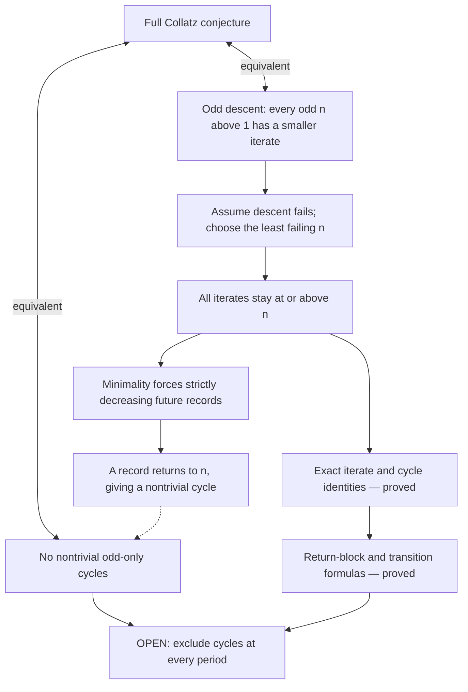

# Collatz Project: a stepwise proof map

## Goal

Define the Collatz map on positive integers by

- `C(n) = n / 2` when `n` is even;
- `C(n) = 3n + 1` when `n` is odd.

The conjecture says every positive integer eventually reaches 1.

The active proof strategy is symbolic: derive exact identities for arbitrary odd inputs, then prove orbit-wide inequalities from the valuation dynamics. Finite orbit checks and lists of residue classes are supplementary records, not the route to the global theorem.

For odd inputs, skip the even terms and use the Syracuse map

`S(n) = (3n + 1) / 2^v2(3n + 1)`, for odd `n`,

where `v2(m)` is the exponent of 2 dividing `m`. The output of `S` is odd. Every positive Collatz orbit reaches an odd number after finitely many halvings, so proving that every odd number reaches 1 under `S` is equivalent to the original conjecture.

## A precise proof target

It would suffice to prove the **descent property**:

> For every odd `n > 1`, some iterate `S^j(n)` is strictly smaller than `n`.

If this property holds, strong induction finishes the proof: the smaller odd iterate is below `n`, so by induction it reaches 1, and therefore so does `n`. Conversely, if the Collatz conjecture is true, every odd `n > 1` eventually reaches 1 and hence has a smaller iterate. Thus this is an equivalent target, not an easier theorem already established.

## Exact iterate formula and global descent condition

For an odd starting value `x_0 = n`, define its Syracuse orbit by `x_i = S(x_{i-1})`, the exact 2-adic valuation at step `i` by `a_i = v_2(3x_{i-1}+1)`, and the cumulative valuation by `A_0=0` and `A_j = a_1 + ··· + a_j`. Define `c_0=0` and `c_{j+1}=3c_j+2^{A_j}`. Then for every `j ≥ 1`,

`2^{A_j} x_j = 3^j n + c_j`,

and hence

`c_j = Σ_{i=0}^{j-1} 3^{j-1-i} 2^{A_i}`.

**Proof.** The identity holds at `j=0`. If `2^{A_j}x_j=3^j n+c_j`, then

`2^{A_j+a_{j+1}}x_{j+1} = 3(2^{A_j}x_j)+2^{A_j} = 3^{j+1}n+(3c_j+2^{A_j})`.

This is the same identity at `j+1`; expanding the recurrence for `c_j` gives the sum.

Therefore an iterate is strictly smaller exactly when

`x_j < n  ⇔  (2^{A_j}-3^j)n > c_j`.

In particular, `A_j log 2 > j log 3` is necessary, but it is not by itself sufficient: the positive correction `c_j` must also fit inside the descent margin.

The same condition has a useful logarithmic form:

`log(x_j/n) = j log 3 - A_j log 2 + Σ_{i=0}^{j-1} log(1 + 1/(3x_i))`.

If a hypothetical counterexample never drops below its odd starting value `n`, then `x_i ≥ n` for every `i`, so for every `j` it must satisfy

`A_j log 2 ≤ j log(3 + 1/n)`.

This is a necessary constraint on a non-descending orbit, not a proof that one cannot exist. The next global proof obligation is to derive a structural lower bound on the cumulative valuations along any such orbit that contradicts this upper bound, without enumerating residue classes.

This can be stated as a precise prefix-crossing target. For a fixed odd `n>1`, if some `j` satisfies

`A_j > j log_2(3+1/n)`,

then a smaller odd iterate has already occurred by time `j`. Indeed, if every `x_i≥n` through `j`, the exact product identity gives

`2^{A_j}x_j = n∏_{i=0}^{j−1}(3+1/x_i) ≤ n(3+1/n)^j`,

and `x_j≥n` would imply the opposite inequality `A_j≤j log_2(3+1/n)`. Thus the Collatz conjecture is equivalent to proving that every odd `n>1` has a finite prefix crossing this line: crossing gives descent and strong induction; if the conjecture holds, continuing after reaching `1` adds valuation `2` at every Syracuse step, eventually crossing because `log_2(3+1/n)<2`.

The remaining task is therefore deterministic: prove this crossing for each fixed orbit from the block transition law. Density estimates do not supply it. Tao's 2019 theorem proves that almost every starting value, in logarithmic density, eventually reaches below any function tending to infinity; the paper explains that the relevant measures are not invariant under Collatz, so typicality cannot simply be propagated from one iterate to the next ([Tao, *Almost all orbits of the Collatz map attain almost bounded values*](https://arxiv.org/abs/1909.03562)). The exceptional individual orbit is exactly what the project still has to rule out.

The prefix cap alone cannot force a crossing. For any odd `n≥3`, put `λ_n=log_2(3+1/n)`, so `1<λ_n<2`, and define the abstract integer sequence

`A_j=floor(jλ_n)`,  `a_j=A_j−A_{j−1}`.

Then every `a_j` is `1` or `2`, `A_j≤jλ_n` for every prefix, and `A_j/j→λ_n`. Thus the necessary non-descent cap admits perfectly regular low-mean valuation schedules. This construction does not claim that the schedule is realized by a Syracuse orbit; it shows why a proof must use the transition congruences, not only a stronger average bound. The next target is to combine the prefix cap with `a_{k+1}−1=v_2(3^{t_k}u_k−1)` and the carry constraints to rule out every realizable schedule that stays below the crossing line.

For an unbounded non-descending orbit, the cap improves asymptotically to the critical slope `c=log_2 3`. Because the Syracuse map is deterministic, any repeated value makes the orbit eventually periodic and hence bounded; therefore every unbounded orbit satisfies `x_i→∞`. With `ε_i=log_2(1+1/(3x_i))`, the exact identity above gives

`A_j/j = c + (1/j)Σ_{i<j}ε_i − (1/j)log_2(x_j/n)`.

Here `ε_i→0`, so its Cesàro mean tends to zero, while the last term is nonnegative. Therefore

`limsup_{j→∞} A_j/j ≤ log_2 3`.

In particular, valuation-one steps have lower density at least `2−log_2 3≈0.4150`, and `limsup N_s(j)/j≤(log_2 3−1)/(s−1)` for `N_s(j)=#{i≤j:a_i≥s}`. A bounded orbit is eventually periodic, and its eventual cycle has the opposite strict inequality: over a period `m`, `2^A=∏_{i=0}^{m−1}(3+1/x_i)>3^m`, so `A/m>log_2 3`. Thus the unresolved cases split into unbounded non-descenders with at most critical asymptotic valuation mean and nontrivial cycles. The abstract schedule `A_j=floor(j log_2 3)` also meets the critical cap, so the exact transition law is still needed.

The unbounded case has two distinct mean regimes. Suppose a non-descending orbit is strictly subcritical, so `limsup A_j/j<c`; choose `δ>0` with `A_j≤(c−δ)j` for all sufficiently large `j`. The exact identity then yields

`log_2(x_j/n)=jc−A_j+Σ_{i<j}ε_i ≥ δj`,  `ε_i=log_2(1+1/(3x_i))`.

Thus `x_j≥n2^{δj}` eventually. Since `ε_i≤1/(3x_i ln 2)`, the correction series `Σ ε_i` converges, and more precisely

`log_2(x_j/n)=jc−A_j+R_∞+o(1)`,  `R_∞=Σ_{i=0}^{∞}ε_i<∞`.

Consequently a strict subcritical non-descender would have exponential growth, with lower rate at least `δ` and upper rate at most `c−1` because `A_j≥j`. The remaining unbounded boundary case has `limsup A_j/j=c`; its correction sum need not converge. A pointwise proof must address both regimes through the transition law.

## Exact length of a run with valuation one

Let `x_0=n` be odd, set `x_{i+1}=S(x_i)`, and write `a_{i+1}=v_2(3x_i+1)`. For every integer `r ≥ 0`,

`a_1 = ··· = a_r = 1  ⇔  v_2(n+1) ≥ r+1`.

Thus the initial run of valuation-one steps has exactly `v_2(n+1)-1` terms, followed by a step whose valuation is at least 2.

**Proof.** Whenever `a_{i+1}=1`,

`x_{i+1}+1 = (3x_i+1)/2 + 1 = 3(x_i+1)/2`.

So if the first `r` valuations are 1, iteration gives `x_r+1=3^r(n+1)/2^r`. Since `x_r` is odd, `x_r+1` is even; because `3^r` is odd, this forces `v_2(n+1)≥r+1`. Conversely, suppose `v_2(n+1)≥r+1`. Inductively, before each of the first `r` steps, `v_2(x_i+1)=v_2(n+1)-i≥2`. Hence `3x_i+1=3(x_i+1)-2` is divisible by 2 but not by 4, so `a_{i+1}=1` and `v_2(x_{i+1}+1)=v_2(x_i+1)-1`. After those `r` steps the valuation of `x_r+1` is at least 1. Taking `r=v_2(n+1)-1`, it is exactly 1, so `x_r≡1 (mod 4)` and the next `3x_r+1` is divisible by 4. The run therefore ends exactly there.

**Corollary.** Every infinite Syracuse sequence has infinitely many steps with `a_i≥2`: otherwise all sufficiently late valuations would equal 1, contradicting the finite run-length formula at the odd value where that tail begins. This only proves infinitude, not positive density or a lower bound on cumulative valuations. The global descent problem remains open; a useful next step is to control the lengths of these runs together with the sizes of the valuations that end them.

## Exact return-block formula

Take an odd value `x` with `a=v_2(3x+1)≥2`, and let `y=S(x)`. Set `t=v_2(y+1)` and `u=(y+1)/2^t`, so `u` is odd. The run-length lemma says that the next `t-1` odd steps from `y` all have valuation 1. Let `z` be the value after those `t-1` steps. Then

`z+1 = 3^{t-1}(y+1)/2^{t-1} = 2·3^{t-1}u`,

and substituting `x=(2^a y-1)/3` and `y=2^t u-1` gives the exact block difference

`3(z-x) = 2^a - 2 - u(2^{a+t} - 2·3^t)`.

Consequently this block strictly descends from its own starting value `x` exactly when

`u(2^{a+t} - 2·3^t) > 2^a - 2`.

This gives a critical threshold for possible block descent. Since

`2^{a+t} - 2·3^t = 2^{t+1}(2^{a-1} - (3/2)^t)`,

if `(a+t-1)/t ≤ log_2 3`, then the parenthesized term is nonpositive, so `z-x>0`: the block necessarily expands. Thus a block can strictly descend only if its mean valuation `(a+t-1)/t` is greater than `log_2 3`. This condition is necessary, not sufficient, because the exact descent test still depends on `u`.

A sufficient condition that guarantees descent for every possible odd `u≥1` is

`2^a(2^t - 1) > 2·3^t - 2`.

Writing the block mean as `q=(a+t-1)/t`, this sufficient condition is equivalently

`q > λ_t := 1 + (1/t) log_2((3^t-1)/(2^t-1))`.

The threshold satisfies

`λ_t = log_2 3 + η_t`,  where  `η_t=(1/t)log_2((1-3^{-t})/(1-2^{-t})) > 0`,

and `η_t → 0` as `t → ∞`. In fact, the threshold decreases strictly with `t`. To see this, put `R_t=(1-3^{-t})/(1-2^{-t})`, `x=2^{-t}`, and `y=3^{-t}`. Then

`R_t - R_{t+1} = (3x - 4y + xy)/(6(1-x)(1-x/2)) > 0`,

because `x/y=(3/2)^t ≥ 3/2`, so `3x-4y>0`. Also `R_t>1` and `R_t→1`. Thus `η_t=(log_2 R_t)/t` is positive, strictly decreasing, and tends to zero; consequently `λ_t` decreases to `log_2 3`.

As a uniform corollary, for every fixed `ε>0` there is a length `T` such that every block with `t≥T` and `q≥log_2 3+ε` contracts, regardless of `u`. This does not show that every orbit supplies those means; controlling the actual coupled block parameters remains the global problem.

More quantitatively, define

`δ_t=(2^{-t}-3^{-t})/(1-2^{-t})`,

so `η_t=(1/t)log_2(1+δ_t)`. Since `0<δ_t<2^{1-t}`, the elementary inequality `log_2(1+δ)≤δ/ln 2` gives

`0 < η_t < 2^{1-t}/(t ln 2)`.

Thus the guaranteed-descent threshold gap is `O(2^{-t}/t)`. Means at most `log_2 3` force expansion; means above `λ_t` guarantee descent regardless of `u`; between these thresholds the coarse test is inconclusive, and the exact `u`-dependent test or its modulo-3 refinement is needed.

Because `R_t≤R_1=4/3<2`, the width of this inconclusive band, measured in the integer parameter `a-1`, is `log_2 R_t<1`. Put `c=log_2(3/2)`. For a fixed block length `t`, the mean tests therefore give the following integer classification:

- If `a≤floor(tc)+1`, then `q≤log_2 3`, so the block expands.
- If `a≥floor(tc)+3`, then `q>λ_t`, so the block contracts for every `u`.
- Only the single intermediate integer `a=floor(tc)+2` can fall into the inconclusive band; whether it does depends on the fractional part of `tc`. If it does, the exact `u`-dependent criterion decides that block.

This isolates the local ambiguity to at most one valuation level per block length. It still gives no bound on how often the orbit chooses that level or on the combined drift of successive blocks.

The possible candidate can be tested without logarithms. Set `h=floor(t log_2(3/2))`, `f=t log_2(3/2)-h`, and `a=h+2`. Then

`q-log_2 3 = (1-f)/t`,  while  `λ_t-log_2 3 = (log_2 R_t)/t`.

So the candidate is already guaranteed to contract if `1-f>log_2 R_t`. Otherwise use the exact block criterion: with `D=2^{h+t+1}-3^t>0` (since `h+1>t log_2(3/2)`), it contracts exactly when

`uD > 2^{h+1}-1`.

This is a positive-integer comparison for the sole possible local gap. The orbit-wide problem still requires controlling these `u` values together with the adjacent block transitions.

There is an exact consequence for the next block whenever this candidate fails to contract. Index this candidate as block `k`, so `a_k=h+2`, `t_k=t`, and `u_k=u`. Put `M=2^{h+1}` and suppose `uD≤M-1`. Then `r=Du+1≤M`, and the block endpoint formula gives

`3(x_{k+1}-x_k)=2(M-1-uD)`.

Thus strict inequality `uD<M-1` means this block expands. The transition law also gives

`3^t u-1 = 2^t M u-r`.

Because `r` is even, `r≤2^{h+1}`, and `v_2(2^t M u)=t+h+1>v_2(r)`, taking the 2-adic valuation yields the exact next-valuation relation

`a_{k+1}-1=v_2(Du+1)≤h+1`.

So a genuinely expanding block at the only possible gap forces `a_{k+1}≤h+1=a_k-1`. In the equality case `uD=M-1`, the block returns to its starting point, `S^t(x_k)=x_k`, and gives a periodic orbit with period dividing `t`. This constrains a local transition but does not rule out an arbitrary non-descending orbit.

For a strict expansion, this next-block restriction has a two-case refinement. Put `b=v_2(Du+1)=a_{k+1}-1`, `s=(Du+1)/2^b` (odd), and `ℓ=t+h+1-b`. Then

`S(x_{k+1})=2^ℓu-s`.

Since `Du+1<M`, we have `b≤h` and `ℓ≥t+1`. If `s>1`, then

`t_{k+1}=v_2(s-1)≤h-b`,

because `s<2^{ℓ-t}` makes `v_2(s-1)≤ℓ-t-1<ℓ`, so the smaller 2-adic valuation in `S(x_{k+1})+1=2^ℓu-(s-1)` is `v_2(s-1)`. Therefore `t_{k+1}≤h-b<t` and `a_{k+1}+t_{k+1}≤h+1=a_k-1`. If `s=1`, then `t_{k+1}=ℓ≥t+1` and `u_{k+1}=u`; moreover

`q_{k+1}=1+b/ℓ < 1+log_2(3/2)=log_2 3`,

since `b≤h≤t log_2(3/2)<ℓ log_2(3/2)`. The next block is then also forced to expand. Thus a strictly expanding exceptional block either leads to a shorter next run and smaller parameter sum, or to a longer next run followed by another forced expansion. This dichotomy is exact but still leaves the long-term orbit behavior open.

Let `H_k=a_k+t_k`. Across a strict expanding exceptional block, `H_{k+1}=H_k` when `s=1`; when `s>1`, `H_{k+1}≤a_k-1=H_k-(t_k+1)`. The `s=1` branch puts the next block below the critical mean, so it ends any consecutive chain of exceptional-gap expansions.

For a chain of `L` such blocks beginning at block `k`, every transition within the chain must therefore have `s>1`. Hence `t` strictly decreases at each link, and `H` drops by at least `t+1`. If the chain blocks are indexed `i=1,…,L`, then `t_i≥L-i+1`; summing the drops gives

`H_L≤H_1-Σ_{i=1}^{L-1}(t_i+1)≤H_1-(L^2+3L-4)/2`.

Since every block has `H_L≥3`, this is equivalent to `(L+1)(L+2)≤2H_1`, or

`L≤floor((sqrt(8H_1+1)-3)/2)`.

Here `H_1` is the value at the chain's first block. This bounds only consecutive expansions of this exceptional type; it does not rule out other orbit behavior or prove the full conjecture.

There is also a uniform cap on the total growth across such a chain. For block `i`, put `c=log_2(3/2)`, `h_i=floor(t_i c)`, and `f_i=t_i c-h_i`. At the exceptional valuation `a_i=h_i+2`, the exact logarithmic drift is

`d_i=t_i(log_2 3-q_i)+ε_i=ε_i-(1-f_i)`.

Since the block expands, `d_i>0`; hence `d_i<ε_i<β_{t_i}`, where `β_t=-log_2(1-2^{-t})`. The chain's `t_i` are distinct positive integers, so

`Σ d_i < Σ_{t=1}^∞ β_t = -log_2 P`,  where  `P=∏_{t=1}^∞(1-2^{-t})`.

For `0≤x_i≤1`, `∏(1-x_i)≥1-Σx_i`. Applying this to the tail gives `∏_{t=3}^∞(1-2^{-t})≥1-Σ_{t=3}^∞2^{-t}=3/4`, and hence `P≥(1/2)(3/4)(3/4)=9/32`. Therefore `Σd_i≤log_2(32/9)`, and telescoping gives

`(x_end+1)/(x_start+1)<32/9`.

Thus a consecutive run of these exceptional expansions can increase its endpoint by less than a factor `32/9`, independently of its starting value. Other block types remain uncontrolled.

Integrality sharpens this local test. From `3x=2^{a+t}u-2^a-1`, reduction modulo 3 gives `u≡0 (mod 3)` when `a` is odd, and `u≡(-1)^{t+1} (mod 3)` when `a` is even. Since `u` is positive and odd, its corresponding lower bound is `u≥3` for odd `a`, `u≥1` for even `a` and odd `t`, and `u≥5` for even `a` and even `t`. Thus, writing `C=2^{a+t}-2·3^t`, a sharper sufficient criterion is `C>0` and `u_min C>2^a-2`, with `u_min` chosen from those three cases.

This is only a local block criterion. For example, `9 → 7 → 11 → 17` is a block with `a=2`, `t=3`, and it grows from 9 to 17.

The block parameters also obey an exact transition law. Index successive blocks by `k`, with block start `x_k`, valuation `a_k`, post-step value `y_k=S(x_k)=2^{t_k}u_k-1`, and next block start `x_{k+1}=2·3^{t_k-1}u_k-1`. Then

`a_{k+1}-1 = v_2(3^{t_k}u_k-1)`,

and, on writing `y_{k+1}=2^{t_{k+1}}u_{k+1}-1`,

`3^{t_k}u_k-1 = 2^{a_{k+1}-1}(2^{t_{k+1}}u_{k+1}-1)`.

Indeed, `3x_{k+1}+1=2(3^{t_k}u_k-1)`, and dividing by its exact power of 2 gives `y_{k+1}`. Thus adjacent block parameters cannot be chosen independently. This is an exact recurrence, but it does not yet bound their long-run averages.

The recurrence also carries information modulo a high power of 3. Put `b_k=a_{k+1}−1`. Adding `2^{b_k}` to both sides gives

`2^{b_k+t_{k+1}}u_{k+1}=3^{t_k}u_k+2^{b_k}−1`,

so, modulo `3^{t_k}`,

`u_{k+1} ≡ 2^{−(b_k+t_{k+1})}(2^{b_k}−1) (mod 3^{t_k})`.

The inverse power of 2 is taken modulo `3^{t_k}`. In particular,

`min(v_3(u_{k+1}),t_k) = 0` if `b_k` is odd, and `min(v_3(u_{k+1}),t_k)=min(t_k,1+v_3(b_k))` if `b_k` is even.

For even `b_k`, this follows from `v_3(2^{b_k}−1)=1+v_3(b_k)` by LTE; for odd `b_k`, `2^{b_k}−1` is a 3-adic unit. Thus when `a_{k+1}` is odd, the next block parameter satisfies

`u_{k+1} ≥ 3^{min(t_k,1+v_3(a_{k+1}−1))}`.

Inserting this into the exact local contraction test gives a transition-aware sufficient condition: if `a_{k+1}` is odd, `C_{k+1}=2^{a_{k+1}+t_{k+1}}−2·3^{t_{k+1}}>0`, and

`3^{min(t_k,1+v_3(a_{k+1}−1))} C_{k+1} > 2^{a_{k+1}}−2`,

then block `k+1` contracts. This strengthens the earlier modulo-3 lower bound on `u`, but does not yet force enough contractions along every orbit.

Taking logarithms gives a telescoping form of this transition. Put `b_k=a_{k+1}−1` and

`δ_k=log_2(1+(2^{b_k}−1)/(3^{t_k}u_k))`.

Adding `2^{b_k}` to the transition equation yields `2^{b_k+t_{k+1}}u_{k+1}=3^{t_k}u_k+2^{b_k}−1`, and hence

`b_k−t_k log_2(3/2) = t_k−t_{k+1}+log_2(u_k/u_{k+1})+δ_k`.

Here `0<δ_k<1`, because `b_k≥1` and `2^{b_k}≤3^{t_k}u_k−1`. Summing over `k=1,…,m` cancels the intermediate run and `u` terms:

`Σ_{k=1}^m(a_{k+1}−1) = log_2(3/2) Σ_{k=1}^m t_k + t_1−t_{m+1}+log_2(u_1/u_{m+1})+Σ_{k=1}^m δ_k`.

Using `x_{k+1}+1=2·3^{t_k−1}u_k`, this correction is exactly the existing next-block drift term:

`δ_k = log_2(1+(2^{a_{k+1}}−2)/(3(x_{k+1}+1))) = ε_{k+1}`.

Thus the telescope expresses the known block-drift correction in transition coordinates. Its endpoint terms can grow, so this re-expression alone does not force descent or provide an independent bound.

## Exact logarithmic drift across blocks

For block `k`, define

`α_k=(1-2^{1-a_k})/(2^{t_k}u_k)` and `ε_k=log_2(1/(1-α_k))`.

Using `3x_k+1=2^{a_k}y_k`, the same correction has the state-based form

`ε_k=log_2(1+(2^{a_k}-2)/(3(x_k+1)))`.

The endpoint formulas give

`(x_{k+1}+1)/(x_k+1) = 2^{t_k(log_2 3-q_k)}/(1-α_k)`,

where `q_k=(a_k+t_k-1)/t_k`. Hence, after `m` complete blocks,

`log_2((x_{m+1}+1)/(x_1+1)) = Σ_{k=1}^m (t_k(log_2 3-q_k)+ε_k)`.

In particular, a single block contracts exactly when its mean valuation exceeds its state-dependent threshold:

`q_k > log_2 3 + ε_k/t_k = log_2 3 + (1/t_k)log_2(1+(2^{a_k}-2)/(3(x_k+1)))`.

This is an exact local test; the unresolved issue is to control the sum of these block drifts along every orbit.

Since `Σ t_k q_k=Σ(a_k+t_k-1)`, and after the initial run of `r` valuation-one steps the first block start satisfies `x_1+1=(3/2)^r(n+1)`, this is equivalently

`Σ_{k=1}^m (a_k-1) = j log_2(3/2) + Σ_{k=1}^m ε_k - log_2((x_{m+1}+1)/(n+1))`,

where `j=r+Σ t_k` is the total number of odd steps at that block boundary. This identity is exact. Since `x_1+1=(3/2)^r(n+1)`,

`Σ_{k=1}^m (t_k(log_2 3-q_k)+ε_k) < -r log_2(3/2)`

is exactly the condition that this block-boundary value `x_{m+1}` lies below `n`. Finding such a boundary would prove descent; it is sufficient but not necessary, since an intermediate iterate may fall below `n` before the block ends.

The exact 3-adic residue gives a stronger lower bound on `u_k` than its valuation alone. For `k≥2`, put `M_k=3^{t_{k-1}}` and let `R_k∈{0,…,M_k−1}` be the unique residue satisfying

`R_k ≡ 2^{−(a_k−1+t_k)}(2^{a_k−1}−1) (mod M_k)`.

The transition congruence gives `u_k≡R_k (mod M_k)`. Since `u_k` is positive odd and `M_k` is odd, define `U_k^*=R_k` when `R_k` is odd, and `U_k^*=R_k+M_k` when `R_k` is even. Then `u_k≥U_k^*`. For the first block, the modulo-3 condition gives `U_1^*=3` if `a_1` is odd, `U_1^*=1` if `a_1` is even and `t_1` is odd, and `U_1^*=5` if both are even.

For example, the `9→17` return-block transition has `(a_1,t_1,u_1)=(2,3,1)` and `(a_2,t_2)=(2,1)`. It gives `u_2≡7 (mod 27)`, so positivity and oddness force `u_2≥7` (in fact `u_2=7`).

Since `ε_k=−log_2(1−(1−2^{1−a_k})/(2^{t_k}u_k))`, set `Γ_k^*=−log_2(1−1/(2^{t_k}U_k^*))`; then `ε_k<Γ_k^*`. Therefore the residue-sensitive finite-prefix condition

`Σ_{k=1}^m (t_k(log_2 3-q_k)+Γ_k^*) < -r log_2(3/2)`

also guarantees `x_{m+1}<n`. This can sharpen a descent certificate when the transition residue forces a large least positive odd representative; it still does not show that such a prefix must occur on every orbit.

### Exact contraction threshold for the residue carry

For the transition from block `k` to block `k+1`, write `u_{k+1}=U_{k+1}^*+2M_k Q_k`, where `M_k=3^{t_k}` and `Q_k` is a nonnegative integer. Let

`B_{k+1}=2^{a_{k+1}}−2` and `C_{k+1}=2^{a_{k+1}+t_{k+1}}−2·3^{t_{k+1}}`.

The exact block endpoint difference becomes

`3(x_{k+2}−x_{k+1}) = B_{k+1}−C_{k+1}U_{k+1}^*−2M_k C_{k+1}Q_k`.

If `C_{k+1}≤0`, the block expands. If `C_{k+1}>0`, it contracts exactly when `Q_k≥Q_k^{min}`, where

`Q_k^{min}=max(0, floor((B_{k+1}−C_{k+1}U_{k+1}^*)/(2M_k C_{k+1}))+1)`.

Thus each positive-`C` block has an exact carry threshold separating contraction from non-contraction. The orbit-wide problem now includes controlling how often its transition carries cross these thresholds; the residue identity alone does not do that.

The same carry also gives a lower bound on the preceding odd parameter. Substituting `u_{k+1}=U_{k+1}^*+2M_kQ_k` into the transition equation yields

`u_k = W_k+2^{b_k+t_{k+1}+1}Q_k`,

where

`W_k=(2^{b_k+t_{k+1}}U_{k+1}^*−2^{b_k}+1)/3^{t_k}`.

The residue defining `U_{k+1}^*` ensures that `W_k` is an integer; its numerator is `2^{b_k}(2^{t_{k+1}}U_{k+1}^*−1)+1`, so `W_k` is positive and odd. Hence `u_k≥W_k`, and the current block's correction can use the stronger lower bound `V_k=max(U_k^*,W_k)`, giving `ε_k<−log_2(1−1/(2^{t_k}V_k))`. Equivalently, the next-block contraction threshold `Q_k≥Q_k^{min}` can be read as the incoming-parameter threshold `u_k≥W_k+2^{b_k+t_{k+1}+1}Q_k^{min}` when `C_{k+1}>0`. This is a one-step look-ahead refinement; the orbit-wide carry frequency remains uncontrolled.

### Exact residue class from both neighboring transitions

For `k≥2`, the transition into block `k` fixes `u_k` modulo `M_k=3^{t_{k-1}}`; let `U_k^*` be its least positive odd representative. The transition out of block `k` fixes its exact 2-adic valuation: with `b_k=a_{k+1}−1`,

`v_2(3^{t_k}u_k−1)=b_k`.

Let `s_k` be the unique odd integer in `[1,2^{b_k}−1]` satisfying `3^{t_k}s_k≡1 (mod 2^{b_k})`. There is a unique `q_k` in `[0,2^{b_k−1}−1]` satisfying

`M_k q_k ≡ (s_k−U_k^*)/2 (mod 2^{b_k−1})`,

with the modulus-one case `b_k=1` interpreted as `q_k=0`. Then `L_k=U_k^*+2M_kq_k` is the least positive representative satisfying both neighboring congruences. In particular, every positive odd `u_k` satisfying them has the form

`u_k=L_k+2^{b_k}M_k h`,  `h≥0`.

Put `r_k=(3^{t_k}L_k−1)/2^{b_k}`. The exact valuation condition requires `r_k+h` to be odd, so if `δ_k=0` for odd `r_k` and `δ_k=1` for even `r_k`, every actual transition parameter lies in the more restrictive progression

`u_k=L_k+2^{b_k}M_k(δ_k+2j_k)`,  `j_k≥0`.

Thus `u_k≥L_k+2^{b_k}M_kδ_k`, a lower bound that combines the incoming 3-adic residue with the outgoing exact 2-adic valuation. Taking the maximum of this bound, `U_k^*`, and the successor-derived `W_k` further sharpens the correction estimate for `ε_k`. This is a local adjacent-transition constraint; it does not yet control the frequency or cumulative effect of carries along an entire orbit.

### Contraction threshold on the coupled progression

Write the exact progression as `u_k=Λ_k+P_kj_k`, where `Λ_k=L_k+2^{b_k}M_kδ_k` and `P_k=2^{b_k+1}M_k`. The endpoint difference is `3(x_{k+1}−x_k)=B_k−C_ku_k`, with `B_k=2^{a_k}−2` and `C_k=2^{a_k+t_k}−2·3^{t_k}`. If `C_k≤0`, the block strictly expands. If `C_k>0`, put `H_k=floor(B_k/C_k)`. Then the block strictly contracts exactly when

`j_k≥J_k^{min}:=max(0, floor((H_k−Λ_k)/P_k)+1)`.

Consequently, if `Λ_k>H_k` every parameter in this coupled residue class contracts; otherwise only the finite index range `0≤j_k<J_k^{min}` can be non-contracting. This is an exact local test using both neighboring transitions. It does not show that non-contracting blocks are too sparse or that their total drift is bounded along a full orbit.

### The coupled index determines the next run length

For the same progression, define

`Θ_k=(3^{t_k}Λ_k+2^{b_k}−1)/2^{b_k+1}` and `c_k=3^{t_k}M_k`.

The parity choice `δ_k` makes `Θ_k` an integer: using `r_k=(3^{t_k}L_k−1)/2^{b_k}`, it equals `(r_k+3^{t_k}M_kδ_k+1)/2`, whose numerator is even. Substituting `u_k=Λ_k+2^{b_k+1}M_kj_k` into the transition equation gives

`2^{t_{k+1}−1}u_{k+1}=Θ_k+c_kj_k`,

so `t_{k+1}=1+v_2(Θ_k+c_kj_k)`. Since `c_k` is odd, for every `r≥0` the condition `t_{k+1}≥r+1` selects exactly one residue class of `j_k` modulo `2^r`; exact equality `t_{k+1}=r+1` selects one class modulo `2^{r+1}`. Therefore, among the `J_k^{min}` candidate indices for a non-contracting block when `C_k>0`, at most `ceil(J_k^{min}/2^r)` can produce `t_{k+1}≥r+1`. This is a deterministic local branch-counting statement. It does not bound which index an actual orbit follows or prove a global descent.

### Finite block itineraries form exact 2-adic cylinders

Prescribe a finite future word of exact pairs `(s_i,d_i)=(t_{k+i},b_{k+i})`, `1≤i≤m`, where each run length `s_i≥1` and each following valuation `d_i=b_{k+i}≥1`. For the first pair, there is a unique `ρ (mod 2^{s_1})` satisfying `Θ_k+c_kρ≡2^{s_1−1} (mod 2^{s_1})`, since `c_k` is odd. Writing `j_k=ρ+2^{s_1}q` fixes `t_{k+1}=s_1` and gives `u_{k+1}=u_0+2c_kq` with `u_0` positive odd. The condition `b_{k+1}=d_1` is then

`(3^{s_1}u_0−1)/2 + 3^{s_1}c_kq ≡ 2^{d_1−1} (mod 2^{d_1})`.

Its odd coefficient selects one residue class of `q (mod 2^{d_1})`; hence the pair selects one class of `j_k (mod 2^{s_1+d_1})`.

After fixing this pair, let `σ_1` be the least representative of the resulting class and write `j_k=σ_1+2^{s_1+d_1}ℓ`. The transition formula makes `u_{k+1}` affine in `ℓ` with increment `2^{d_1+1}3^{t_k}M_k`, where `M_k=3^{t_{k-1}}`. Since the next incoming modulus is `M_{k+1}=3^{t_k}`, its coupled index is affine in `ℓ` with odd coefficient `M_k`. Repeating the same argument for each prescribed pair therefore gives exactly one class of initial `j_k` modulo

`2^{N}`,  `N=Σ_{i=1}^m(s_i+d_i)`.

Thus any interval of `J` consecutive initial indices contains at most `ceil(J/2^N)` representatives of a specified finite itinerary. This is exact local 2-adic counting, not an estimate of which indices an actual orbit visits; it does not establish global descent.

More precisely, because the compatible indices form one class modulo `2^N`, among any `J` consecutive indices the count is either `floor(J/2^N)` or `ceil(J/2^N)`. Its discrepancy from `J/2^N` is less than one, so the natural density in this parameter family is exactly `2^{-N}`. This is density across compatible starting parameters; it gives no time-frequency statement for a single Syracuse orbit. Bridging that distinction is the next obstacle for any argument that tries to turn local 2-adic coding into average drift control.

### Density-one descent checkpoint (classical)

For a fixed length `m`, every exact valuation word `(a_1,…,a_m)` with `A_m=Σa_i` occurs on exactly one odd residue class modulo `2^{A_m+1}`. Inductively, after fixing a prefix with total `A`, varying its starting value by `2^{A+1}q` varies the next odd Syracuse state by `2·3^j q`; this runs through all odd residues modulo the next valuation modulus and the exact next valuation selects one class. Consequently, in natural density among odd starting values, the `a_i` are independent geometric variables with `P(a_i=s)=2^{-s}`. Thus `E[A_m]=2m` and `Var(A_m)=2m`.

The exact iterate formula gives `x_m=(3^m n+c_m)/2^{A_m}`, with `c_m=Σ_{i=0}^{m−1}3^{m−1−i}2^{A_i}`. Since `A_i≤A_m`,

`c_m≤2^{A_m}(3^m−1)/2`.

If `A_m≥9m/5` and `n≥3^m`, then

`x_m/n≤(3/2^{9/5})^m+(3^m−1)/(2n)<1`

for all sufficiently large `m`, so the orbit has a smaller odd iterate by time `m`. Chebyshev's inequality bounds the natural density of the exceptional valuation words by

`P(A_m<9m/5)≤Var(A_m)/(m/5)^2=50/m`.

For each fixed sufficiently large `m`, the finite set `n<3^m` has density zero. Hence the upper density of odd starts with stopping time greater than `m` is at most `50/m`; letting `m→∞` proves that the set of odd starts that never fall below their start has density zero. Even starts immediately decrease under Collatz, so finite stopping time has natural density one among all positive integers. This recovers the classical Terras result by a short valuation-distribution argument; it does **not** eliminate the exceptional zero-density set and therefore does not prove Collatz. See [Terras, “A stopping time problem on the positive integers” (1976)](https://matwbn.icm.edu.pl/ksiazki/aa/aa30/aa3034.pdf).

The same argument gives an exponential tail. Since `2^{8/5}>3`, if `A_m≥8m/5` and `n≥3^m`, then `x_m/n≤(3/2^{8/5})^m+1/2<1` for all sufficiently large `m`. For the geometric valuation law, Chernoff's inequality with `θ=ln(4/3)` gives

`P(A_m<8m/5)≤ρ^m`,  `ρ=(3/5)(4/3)^{8/5}<1`.

Indeed, `ρ<1` is equivalent to `4^8<5^5·3^3`. The finitely many starts below `3^m` have zero natural density for each fixed `m`, so the upper density of odd starts whose first smaller Syracuse iterate occurs after `m` is at most `ρ^m` for sufficiently large `m`. This is a quantitative density statement only: it still allows an individual exceptional orbit with infinite stopping time.

The same cutoff yields a power-saving count up to a height bound. Let `E(X)` count odd `n≤X` that have not fallen below their start by `m=floor(log_3 n)` Syracuse steps. For `3^m≤n<3^{m+1}`, every such `n` must have `A_m<8m/5`. Each valuation word of total `s` occupies one odd class modulo `2^{s+1}`, so it contributes at most `3^m2^{-s}+1` values in this interval. The weighted sum over these words is at most `ρ^m`; their number is at most

`κ^m`,  `κ=(8/3)^{8/5}/(5/3)<3`,

by multiplying each word by `(8/3)^{8m/5-s}` and summing the resulting geometric series. Thus the interval contributes at most `(3ρ)^m+κ^m`. With `K=max(3ρ,κ)<3` and `β=log_3 K<1`, summing over `m≤log_3 X` gives

`E(X)=O(X^β)`,  `β=log_3 K≈0.9635`.

In particular the infinite-stopping-time set has a power-saving upper bound in counting function. This still allows infinitely many exceptions; the estimate only shows that any such set is sparse.

The cutoff can be optimized. Put `c=log_2 3` and choose any fixed `α` with `c<α<2`. For all sufficiently large `m`, `A_m≥αm` and `n≥3^m` force descent by step `m`, since `3/2^α<1`. Define

`κ(α)=α^α/(α−1)^{α−1}`.

The number of positive integer valuation words with sum below `αm` is at most `κ(α)^m`: multiply each word of total `s` by `(α/(α−1))^{αm−s}` and sum the geometric series. Chernoff with `e^θ=α/(2(α−1))` gives `P(A_m<αm)≤(κ(α)/2^α)^m`. Since `2^α>3`, the weighted residue-class contribution is smaller than the word-count error, and the interval `[3^m,3^{m+1})` contributes at most `2κ(α)^m` candidates. Therefore, for each fixed `α>c`, `E(X)=O(X^{log_3κ(α)})`.

Since `d(ln κ)/dα=ln(α/(α−1))>0`, `κ` increases with `α`. Taking `α` down toward `c` shows that for every `β>β_0`,

`E(X)=O_β(X^β)`,  `β_0=log_3(κ(c))≈0.94996`.

This improves the fixed `α=8/5` exponent `0.9635`, but the exponent remains positive; the bound still permits infinitely many non-descending starts.

The additive correction gives an exact endpoint bound. From `c_m≤2^{A_m}(3^m−1)/2`,

`x_m/n≤3^m/2^{A_m}+(3^m−1)/(2n)`.

Thus, for `n≥3^m`, the sharper condition `A_m≥mc+1` already forces `x_m<n`: the two terms are at most `1/2` and strictly less than `1/2`, respectively. Set `α_m=c+1/m`. The low-sum words have `A_m<α_m m`; for `m≥3`, the same residue-class counting bounds their contribution on `[3^m,3^{m+1})` by `3^mκ(α_m)^m/2^{α_m m}+κ(α_m)^m=(3/2)κ(α_m)^m`.

Since `d(ln κ)/dα=ln(α/(α−1))` decreases with `α`,

`κ(α_m)^m≤(c/(c−1))κ(c)^m`.

Summing the interval bounds attains the endpoint exponent itself:

`E(X)=O(X^{β_0})`,  `β_0=log_3(κ(c))≈0.94996`.

This remains a sublinear count, not a proof that the exceptional set is empty.

The endpoint count admits a logarithmic refinement without changing the descent criterion. For `A_m<mc+1`, let `N_m=floor(mc+1)=cm+O(1)`. The number of positive valuation words is exactly

`Σ_{s=m}^{N_m} binom(s−1,m−1)=binom(N_m,m)=O(κ(c)^m/√m)`.

For the weighted residue sum, put `T_s=binom(s−1,m−1)2^{−s}`. Its successive ratio is

`T_s/T_{s−1}=(s−1)/(2(s−m))`.

Because `N_m/m→c<2`, these terms increase geometrically with successive ratios uniformly greater than 1 through `s=N_m`; hence `ΣT_s=O(T_{N_m})=O((κ(c)/3)^m/√m)`. Each interval therefore contributes `O(κ(c)^m/√m)` candidates. Summing the geometric sequence of interval bounds gives

`E(X)=O(X^{β_0}/√(log X))`,  `β_0=log_3(κ(c))≈0.94996`.

The logarithmic saving still allows an infinite exceptional set, so the pointwise obstruction remains open.

On an orbit that never falls below `n`, its final logarithm is nonnegative, so

`Σ(a_k-1) ≤ j log_2(3/2) + Σ ε_k`.

Also `0<α_k<2^{-t_k}`, so `0<ε_k<β_{t_k}:=-log_2(1-2^{-t_k})`. The resulting block-length-sensitive cap is

`Σ(a_k-1) < j log_2(3/2) + Σ β_{t_k}`.

This is another necessary bound for a hypothetical non-descending orbit, not the missing lower bound.

There is also an exact cumulative bookkeeping identity. Let `r` be the initial number of valuation-one steps before the first valuation at least 2, and let `(a_k,t_k)` describe each following complete block. After `m` blocks,

`j = r + Σ_{k=1}^m t_k`,  `A_j = r + Σ_{k=1}^m (a_k+t_k-1)`,

so `A_j-j = Σ_{k=1}^m (a_k-1)`. If the orbit never falls below its starting value `n`, the earlier logarithmic bound therefore forces

`Σ_{k=1}^m (a_k-1) ≤ (r + Σ_{k=1}^m t_k) log_2((3+1/n)/2)`

at every such block boundary. This is a necessary upper bound for a hypothetical non-descending orbit. Proving a contradictory lower bound from the dynamics, while allowing expanding blocks such as the one from 9, is still open.

### Frequency constraints on a hypothetical non-descending orbit

Fix an odd `n>1` and suppose no odd Syracuse iterate falls below `n`. Put

`c_n=log_2((3+1/n)/2)` and `N_s(j)=#{1≤i≤j : a_i≥s}` for integers `s≥2`.

The exact iterate inequality gives `Σ_{i=1}^j(a_i−1)≤j c_n`. Each index counted by `N_s(j)` contributes at least `s−1` to this sum, so for every `j` and `s≥2`,

`N_s(j) ≤ floor(j c_n/(s−1))`.

In particular, if `Z_j=#{1≤i≤j:a_i=1}`, then

`Z_j/j ≥ 1−c_n ≥ log_2(6/5)`,

because `n≥3` implies `c_n≤log_2(5/3)`. Thus any orbit that fails the descent target must have valuation-one steps on a positive lower density of its odd steps, while valuations at least `s` have upper density at most `c_n/(s−1)`.

There is an equivalent constraint on complete return blocks. If `r` is the initial run of valuation-one steps and `j_m=r+Σ_{k=1}^m t_k` is the endpoint after `m` blocks, then the `m` block-start valuations are all at least 2, so `m≤j_m c_n`. Consequently

`(1/m)Σ_{k=1}^m t_k ≥ 1/c_n−r/m`,

and the lower limit of the mean block length is at least `1/c_n`. This is a necessary frequency condition, not a contradiction: the transition law has not yet supplied an incompatible upper bound on these run lengths.

The logarithmic transition identity sharpens this necessary condition. Let `c=log_2(3/2)`, `T_m=Σ_{k=1}^m t_k`, and `Δ_m=Σ_{k=1}^m δ_k`. Applying the non-descent cap at the endpoint after `m+1` blocks and substituting the telescoped transition identity gives

`(1+c_n)t_{m+1}+log_2 u_{m+1} ≥ Δ_m−(c_n−c)T_m+(a_1−1)+t_1+log_2 u_1−c_n r`,

where `c_n−c=log_2(1+1/(3n))`. Thus a descent-failing orbit must either accumulate only a small transition correction relative to total block length, or let its terminal run/odd parameter grow enough to absorb the positive correction. Bounding these two quantities from the recurrence is the next open step.

## Cycle-exclusion reduction

Let `S(x)=(3x+1)/2^{v₂(3x+1)}` be the Syracuse map on positive odd integers. The Collatz conjecture is equivalent to the absence of nontrivial cycles of `S`.

**Proof.** If every odd `n>1` has an iterate below `n`, strong induction proves that every odd integer reaches `1`: a smaller odd iterate reaches `1` by induction, so the original orbit does too. Even starting values reduce to an odd value by removing powers of two. Thus the descent statement implies Collatz, and Collatz plainly implies descent and excludes nontrivial cycles.

For the other direction, suppose descent fails for at least one odd integer greater than `1`, and let `n` be the least such integer. Every odd iterate `x_j=S^j(n)` is at least `n`. For any odd `y>n`, minimality of `n` says descent does hold from `y`, so some iterate of `y` is strictly smaller than `y`. Starting at `x_1`, repeatedly take the first later orbit value smaller than the current record. Whenever the record is greater than `n`, such a later value exists; all records remain at least `n`. They therefore cannot decrease forever, so one record equals `n`. The orbit returns to `n` and is periodic. The only odd fixed point is `1` (from `2^a n=3n+1`), so this is a nontrivial cycle. Hence, if no nontrivial odd-only cycle exists, descent cannot fail.

This is a proof-target reduction, not a cycle exclusion: arbitrary periods remain open. It shows that the central global task can be stated purely as ruling out every nontrivial odd-only cycle; finite residue checks are not needed for this reduction.

## No odd-only cycles of period at most four

The only periodic orbit of the odd-only Syracuse map with period at most four is the fixed point `1`.

**Proof.** Consider a nontrivial cycle of exact odd-step period `m`, with odd values `x_0,…,x_{m-1}>1`, indices taken modulo `m`, and `a_i=v₂(3x_i+1)`. Since `S(1)=1`, a nontrivial cycle contains no `1`; thus each `x_i≥3`. From `2^{a_i}x_{i+1}=3x_i+1`, multiplication around the cycle gives

`2^A = ∏_{i=0}^{m−1}(3+1/x_i)`,  where `A=Σ a_i`.

Each factor exceeds `3` and is at most `10/3`. At least one `x_i≥5`, since `S(3)=5`, so at least one factor is strictly below `10/3`. Therefore

`3^m < 2^A < (10/3)^m`.

For `m=1`, `2^A` would lie strictly between `3` and `10/3`, which contains no power of two. For `m=2`, it would lie between `9` and `100/9`, also containing no power of two. For `m=4`, it would lie between `81` and `10000/81`, strictly between `2^6=64` and `2^7=128`. These periods are impossible.

For `m=3`, the same bounds force `A=5`, since `27<2^A<1000/27` and the only power of two in that interval is `32`. Write `a=a_0`, `b=a_1`, and `c=a_2`. Eliminating the intermediate orbit values from the three step equations gives

`(2^{a+b+c}−27)x_0 = 2^{a+b}+3·2^a+9`.

With `A=5`, this becomes `5x_0=2^a(2^b+3)+9`. Reduction modulo `5` requires `2^a(2^b+3)≡1 (mod 5)`. Since `a,b,c≥1` and `a+b+c=5`, we have `b∈{1,2,3}`. If `b=1`, the left side is `0 mod 5`. If `b=2`, the congruence requires `a≡3 (mod 4)`, but `a≤2`. If `b=3`, it requires `a≡0 (mod 4)`, but `a=1`. All cases are impossible.

Thus no nontrivial odd-only cycle has period at most four. This cycle exclusion does not rule out longer cycles or nonperiodic orbits and does not establish the Collatz conjecture.

### A minimum-versus-period constraint for every odd-only cycle

Let a nontrivial cycle have exact period `m` and least value `n`. Its `m` orbit values are distinct odd integers, so when sorted they are at least `n,n+2,…,n+2(m−1)`. The cycle product identity gives

`A−m c = Σ_{i=0}^{m−1}log_2(1+1/(3x_i))`,  `c=log_2 3`,

where `A=Σa_i` is an integer strictly greater than `mc`. Define the fractional gap to the next integer by `δ_m=ceil(mc)−mc∈(0,1)`; `mc` is never an integer because `log_2 3` is irrational. Then

`δ_m ≤ A−mc ≤ Σ_{k=0}^{m−1}log_2(1+1/(3(n+2k)))`.

Using `log_2(1+z)≤z/ln 2` and `n+2k≥n` yields the simple necessary bound

`n ≤ m/(3 ln(2) δ_m)`.

Thus a cycle with a large minimum requires `m log_2 3` to lie unusually close below an integer. The bound narrows possible cycle parameters but does not exclude the exceptional periods where `δ_m` is small.

### A sharper minimum-period bound from admissible-state spacing

The preceding estimate counts every odd integer, although a cycle cannot contain multiples of `3`. The minimum `n` is `1` modulo `6` or `5` modulo `6`. The increasing list of odd integers at least `n` that are not divisible by `3` is exactly

- `n,n+4,n+6,n+10,…` if `n≡1 (mod 6)`;
- `n,n+2,n+6,n+8,…` if `n≡5 (mod 6)`.

Let `r_j(n)` be the `j`th value in this list, starting at `j=0`, and sort the cycle values as `y_0<…<y_{m−1}`. Then `y_j≥r_j(n)`, so the exact cycle identity gives

`2^{δ_m} ≤ ∏_i(1+1/(3x_i)) ≤ ∏_{j=0}^{m−1}(1+1/(3r_j(n)))`.

With `ε=0` for `n≡1 (mod 6)` and `ε=1` for `n≡5 (mod 6)`, the spacing gives `r_0(n)=n` and `r_j(n)≥n−ε+3j` for `j≥1`. Applying `log_2(1+z)≤z/ln 2` then implies

`δ_m ≤ (1/(3 ln 2))(1/n + Σ_{j=1}^{m−1}1/(n−ε+3j))`.

Put `N=n−ε`. The function `t↦1/(N+3t)` is convex; applying the midpoint integral bound on each unit interval gives the closed necessary condition

`δ_m ≤ (1/(3 ln 2))(1/n + (1/3) ln((N+3m−3/2)/(N+3/2)))`.

For `m≥3` the reciprocal sum is strictly sharper term-by-term than the earlier sum over all odd values `n+2j`. This refines the minimum-period restriction using only exact state exclusions and an analytic inequality. It still allows parameters when `δ_m` is small, so it is not a cycle exclusion.

The same argument gives a period-only exclusion test. Since every nontrivial cycle value is an odd integer at least `3`,

`2^{δ_m} ≤ ∏_{i=0}^{m−1}(1+1/(3x_i)) ≤ P_m`,

where

`P_m=∏_{k=0}^{m−1}(1+1/(3(3+2k)))=∏_{k=0}^{m−1}(k+5/3)/(k+3/2)`.

Consequently any `m` with `2^{δ_m}>P_m` is impossible as a cycle period. The gamma-function form is

`P_m=Γ(m+5/3)Γ(3/2)/(Γ(5/3)Γ(m+3/2)) ~ C m^{1/6}`

for a positive constant `C`, so `P_m` eventually exceeds `2`. Because `2^{δ_m}<2`, this product filter can exclude only finitely many periods; ruling out long cycles requires additional information from the transition congruences.

### A sharper cycle product filter from the modulo-three obstruction

No value in an odd-only cycle is divisible by `3`: if `3|x_{i+1}`, then `2^{a_i}x_{i+1}=3x_i+1` would give `0≡1 (mod 3)`. If `n` is the minimum of a nontrivial cycle, its next value is strictly larger than `n`. Thus its valuation is `1`, since `a≥2` would give `S(n)=(3n+1)/2^a≤(3n+1)/4<n` for `n>1`. Hence `n≡3 (mod 4)`; together with `3∤n`, this implies `n≥7`.

The increasing list of odd integers at least `7` that are not divisible by `3` is `r_0=7,r_1=11,r_2=13,r_3=17,…`, with `r_{2k}=6k+7` and `r_{2k+1}=6k+11`. Sort the `m` distinct cycle values as `y_0<…<y_{m−1}`. Since each is in this admissible list, `y_j≥r_j`. The cycle product identity therefore yields the sharper necessary condition

`2^{δ_m} ≤ ∏_i(1+1/(3x_i)) ≤ Q_m`,

where

`Q_m=∏_{0≤2k<m}(1+1/(3(6k+7))) · ∏_{0≤2k+1<m}(1+1/(3(6k+11)))`.

Pairing the two factors for each `k` gives `(1+1/(18k+21))(1+1/(18k+33))=1+1/(9k)+O(k^{−2})`; consequently `Q_m~C m^{1/9}` for a positive constant `C`. This improves the coarser `m^{1/6}` product bound, but `Q_m` still grows beyond `2`, whereas `2^{δ_m}<2`. Thus the sharpened product filter also has finite scope: the exact valuation transitions are still needed to exclude arbitrary periods.

### Large-minimum cycles force a continued-fraction convergent

For any nontrivial odd-only cycle of period `m` and minimum `n`, its average valuation satisfies

`c < A/m = (1/m)Σ_i log_2(3+1/x_i) ≤ log_2(3+1/n)`,  `c=log_2 3`.

Therefore

`0 < A/m−c ≤ log_2(1+1/(3n)) ≤ 1/(3n ln 2)`.

Write `A/m=p/q` in lowest terms, with `q≤m`. If `n>2m^2/(3 ln 2)`, then `|p/q−c|<1/(2m^2)≤1/(2q^2)`. Legendre's continued-fraction criterion implies that `p/q` is a convergent of `c`, and it must be an upper convergent. In particular, its denominator `q` divides `m`. Thus every cycle is in one of two cases: `n≤2m^2/(3 ln 2)`, or its mean valuation is one of these restricted rational approximants. This reduces the large-minimum branch to Diophantine structure but does not eliminate either case. Continued-fraction and logarithmic-form methods are classical in cycle analysis; stronger published cycle bounds combine them with computational lower bounds ([Simons–de Weger, *Theoretical and computational bounds for m-cycles*](https://math.deweger.net/papers/%5B35a%5DSidW-3n%2B1-v1.44%5B2010%5D.pdf)).

### Large-minimum cycles force a large next-convergent gap

In the large-minimum case, write `A/m=p/q` in lowest terms and let `q'` be the denominator of the next convergent of `c=log_2 3` after `p/q`. Since `q|m`, write `m=qr`. For a convergent, the standard error bounds give

`1/(q(q+q')) < p/q−c < 1/(q q')`.

Indeed, for the convergent `p_k/q_k=p/q` and next denominator `q_{k+1}=q'`, the exact error has denominator `q(q'+θq)` for some `0<θ<1`.

The cycle logarithmic excess is `D=A−mc=m(p/q−c)`, so `r/(q+q')<D`. On the other hand, the admissible-state spacing above gives

`D ≤ B_{m,n}:=(1/(3 ln 2))(1/n + Σ_{j=1}^{m−1}1/(n−ε+3j)) ≤ m/(3n ln 2)`,

where `ε=0` if `n≡1 (mod 6)` and `ε=1` if `n≡5 (mod 6)`; the final inequality follows by comparing each denominator with `n+2j`.

Combining these inequalities yields the necessary denominator condition

`q+q' > r/B_{m,n} ≥ 3n ln(2)/q > 2q r^2`,

or equivalently `q'/q>2r^2−1`. Thus a large-minimum cycle whose reduced mean has denominator `q` and period `m=qr` requires the next continued-fraction denominator to jump by a factor exceeding `2r^2−1`. The condition is automatic when `r=1`, and it does not exclude the small-minimum branch or all large-minimum cycles; it isolates a further Diophantine obstruction without enumerating convergents.

### A block-coordinate identity for the cycle excess

Partition a hypothetical nontrivial cycle at its valuations `a_k≥2` into `K` return blocks, with cyclic indices. Let `t_k` and `u_k` be the block length and odd parameter from the transition law. Then `m=Σ_k t_k`, `A=m+Σ_k(a_k−1)`, and each transition satisfies

`3^{t_k}u_k−1 = 2^{a_{k+1}−1}(2^{t_{k+1}}u_{k+1}−1)`.

Multiplying around the cycle and taking logarithms gives an exact second expression for `D=A−m log_2 3`:

`D = Σ_k η(t_k,u_k)`,

where

`η(t,u)=log_2((1−1/(3^t u))/(1−1/(2^t u)))=log_2(1+(1−(2/3)^t)/(2^t u−1))>0`.

This expresses the same excess as the state-space product, but now in block variables. The incoming transition also forces, cyclically,

`u_k ≡ 2^{−(a_k−1+t_k)}(2^{a_k−1}−1) (mod 3^{t_{k−1}})`.

Let `U_k^*` be the least positive odd representative of this residue class. Then `u_k≥U_k^*`, and `η(t,u)` decreases with `u`, so

`D ≤ Σ_k η(t_k,U_k^*)`.

In the large-minimum convergent branch this combines with the previous lower bound `r/(q+q')<D` and the state-spacing cap `D≤B_{m,n}`. The resulting comparison is a symbolic necessary condition linking continued-fraction gaps to cyclic block carries. It has not yet produced a contradiction, and the small-minimum branch remains open.

The incoming congruence gives a residue-independent lower bound as well. Write `M_k=3^{t_{k−1}}`. For some integer `ℓ_k`,

`2^{a_k−1+t_k}u_k = 2^{a_k−1}−1+ℓ_k M_k`.

Because `t_k≥1` and `u_k≥1`, the left side exceeds `2^{a_k−1}−1`, so `ℓ_k≥1`. Hence

`2^{t_k}u_k−1 ≥ (3^{t_{k−1}}−1)/2^{a_k−1}`.

Substitution into `η` yields the explicit cyclic upper bound

`D ≤ Σ_k log_2(1 + 2^{a_k−1}(1−(2/3)^{t_k})/(3^{t_{k−1}}−1))`.

Consequently, in the large-minimum convergent branch,

`r/(q+q') < Σ_k log_2(1 + 2^{a_k−1}(1−(2/3)^{t_k})/(3^{t_{k−1}}−1))`.

This removes the need to evaluate each least residue `U_k^*` for this particular upper bound. The remaining task is to control the cyclic sum from the exact valuation pattern; the inequality alone does not rule out a cycle.

## Auxiliary finite congruence certificates

The following exact congruence arguments establish descent on selected classes. They are valid side results, but extending a residue list is not the active proof strategy and does not address the remaining all-integers argument.

### Lemma 1: `n ≡ 1 (mod 4)`

If odd `n > 1` and `n ≡ 1 (mod 4)`, then `S(n) < n`.

**Proof.** Write `n = 4k + 1`, where `k ≥ 1`. Then

`3n + 1 = 12k + 4 = 4(3k + 1)`,

so `v2(3n + 1) ≥ 2`. Therefore

`S(n) ≤ (3n + 1) / 4 = 3k + 1 < 4k + 1 = n`.

The exceptional value `n = 1` is already fixed by `S`.

### Lemma 2: `n ≡ 3 (mod 16)`

If `n = 16k + 3`, where `k ≥ 0`, then `S^2(n) < n`.

**Proof.** First, `3n + 1 = 48k + 10 = 2(24k + 5)`, with `24k + 5` odd, so `S(n) = 24k + 5`. Next,

`3S(n) + 1 = 72k + 16 = 8(9k + 2)`,

so `S^2(n) ≤ 9k + 2 < 16k + 3 = n`. The last inequality follows from `7k + 1 > 0`.

### Lemma 3: `n ≡ 11 (mod 64)`

If `n = 64k + 11`, where `k ≥ 0`, then `S^3(n) < n`.

**Proof.** The first two odd steps are exact:

- `3n + 1 = 192k + 34 = 2(96k + 17)`, so `S(n) = 96k + 17`;
- `3S(n) + 1 = 288k + 52 = 4(72k + 13)`, so `S^2(n) = 72k + 13`.

Then `3S^2(n) + 1 = 216k + 40 = 8(27k + 5)`, so `S^3(n) ≤ 27k + 5 < 64k + 11 = n`.

### Lemma 4: `n ≡ 23, 43, or 55 (mod 64)`

For each of these three classes, `S^3(n) < n`.

**Proof.** Write `n = 64k + r`, with `k ≥ 0`.

- If `r = 23`, then `S(n) = 96k + 35` and `S^2(n) = 144k + 53`. Since `3S^2(n) + 1 = 432k + 160 = 16(27k + 10)`, we have `S^3(n) ≤ 27k + 10 < 64k + 23`.
- If `r = 43`, then `S(n) = 96k + 65`, `S^2(n) = 72k + 49`, and `S^3(n) = 54k + 37 < 64k + 43`.
- If `r = 55`, then `S(n) = 96k + 83` and `S^2(n) = 144k + 125`. Since `3S^2(n) + 1 = 432k + 376 = 8(54k + 47)`, we have `S^3(n) ≤ 54k + 47 < 64k + 55`.
### Lemma 5: `n ≡ 7 or 15 (mod 256)`

For each of these two classes, `S^4(n) < n`.

**Proof.** Write `n = 256k + r`, where `k ≥ 0`.

- If `r = 7`, the first three odd iterates are `384k + 11`, `576k + 17`, and `432k + 13`. Since `3S^3(n) + 1 = 1296k + 40 = 8(162k + 5)`, we have `S^4(n) ≤ 162k + 5 < 256k + 7`.
- If `r = 15`, the first three odd iterates are `384k + 23`, `576k + 35`, and `864k + 53`. Since `3S^3(n) + 1 = 2592k + 160 = 16(162k + 10)`, we have `S^4(n) ≤ 162k + 10 < 256k + 15`.

### Lemma 6: `n ≡ 143 (mod 256)`

If `n = 256k + 143`, where `k ≥ 0`, then `S^4(n) < n`.

**Proof.** The first three odd iterates are exact:

- `3n + 1 = 768k + 430 = 2(384k + 215)`, so `S(n) = 384k + 215`;
- `3S(n) + 1 = 1152k + 646 = 2(576k + 323)`, so `S^2(n) = 576k + 323`;
- `3S^2(n) + 1 = 1728k + 970 = 2(864k + 485)`, so `S^3(n) = 864k + 485`.

Finally, `3S^3(n) + 1 = 2592k + 1456 = 16(162k + 91)`. Since `162k + 91` is odd, this valuation is exactly 4 and `S^4(n) = 162k + 91 < 256k + 143 = n`.

### Lemma 7: `n ≡ 187 (mod 256)`

If `n = 256k + 187`, where `k ≥ 0`, then `S^4(n) < n`.

**Proof.** The odd Syracuse iterates are exact:

- `3n + 1 = 768k + 562 = 2(384k + 281)`, so `S(n) = 384k + 281`;
- `3S(n) + 1 = 1152k + 844 = 4(288k + 211)`, so `S^2(n) = 288k + 211`;
- `3S^2(n) + 1 = 864k + 634 = 2(432k + 317)`, so `S^3(n) = 432k + 317`;
- `3S^3(n) + 1 = 1296k + 952 = 8(162k + 119)`, so `S^4(n) = 162k + 119`.

Each quotient in parentheses is odd, so the listed powers of 2 are the exact valuations. Finally, `256k + 187 - (162k + 119) = 94k + 68 > 0`.

### Lemma 8: `n ≡ 39 (mod 256)`

If `n = 256k + 39`, where `k ≥ 0`, then `S^5(n) < n`.

**Proof.** The first four odd Syracuse iterates are exact:

- `3n + 1 = 768k + 118 = 2(384k + 59)`, so `S(n) = 384k + 59`;
- `3S(n) + 1 = 1152k + 178 = 2(576k + 89)`, so `S^2(n) = 576k + 89`;
- `3S^2(n) + 1 = 1728k + 268 = 4(432k + 67)`, so `S^3(n) = 432k + 67`;
- `3S^3(n) + 1 = 1296k + 202 = 2(648k + 101)`, so `S^4(n) = 648k + 101`.

Each displayed quotient is odd. On the fifth step, `3S^4(n) + 1 = 1944k + 304 = 8(243k + 38)`, so `S^5(n) ≤ 243k + 38 < 256k + 39 = n`, since the difference is `13k + 1 > 0`.

### Lemma 9: `n ≡ 79 (mod 256)`

If `n = 256k + 79`, where `k ≥ 0`, then `S^5(n) < n`.

**Proof.** The first four odd Syracuse iterates are exact:

- `3n + 1 = 768k + 238 = 2(384k + 119)`, so `S(n) = 384k + 119`;
- `3S(n) + 1 = 1152k + 358 = 2(576k + 179)`, so `S^2(n) = 576k + 179`;
- `3S^2(n) + 1 = 1728k + 538 = 2(864k + 269)`, so `S^3(n) = 864k + 269`;
- `3S^3(n) + 1 = 2592k + 808 = 8(324k + 101)`, so `S^4(n) = 324k + 101`.

Each displayed quotient is odd. Finally, `3S^4(n) + 1 = 972k + 304 = 4(243k + 76)`, so `S^5(n) ≤ 243k + 76 < 256k + 79 = n`, since the difference is `13k + 3 > 0`.

### Lemma 10: `n ≡ 95 (mod 256)`

If `n = 256k + 95`, where `k ≥ 0`, then `S^5(n) < n`.

**Proof.** The first four odd Syracuse iterates are exact:

- `3n + 1 = 768k + 286 = 2(384k + 143)`, so `S(n) = 384k + 143`;
- `3S(n) + 1 = 1152k + 430 = 2(576k + 215)`, so `S^2(n) = 576k + 215`;
- `3S^2(n) + 1 = 1728k + 646 = 2(864k + 323)`, so `S^3(n) = 864k + 323`;
- `3S^3(n) + 1 = 2592k + 970 = 2(1296k + 485)`, so `S^4(n) = 1296k + 485`.

Each displayed quotient is odd. On the fifth step, `3S^4(n) + 1 = 3888k + 1456 = 16(243k + 91)`, so `S^5(n) ≤ 243k + 91 < 256k + 95 = n`, since the difference is `13k + 4 > 0`.

### Lemma 11: `n ≡ 123 (mod 256)`

If `n = 256k + 123`, where `k ≥ 0`, then `S^5(n) < n`.

**Proof.** The first four odd Syracuse iterates are exact:

- `3n + 1 = 768k + 370 = 2(384k + 185)`, so `S(n) = 384k + 185`;
- `3S(n) + 1 = 1152k + 556 = 4(288k + 139)`, so `S^2(n) = 288k + 139`;
- `3S^2(n) + 1 = 864k + 418 = 2(432k + 209)`, so `S^3(n) = 432k + 209`;
- `3S^3(n) + 1 = 1296k + 628 = 4(324k + 157)`, so `S^4(n) = 324k + 157`.

Each displayed quotient is odd. On the fifth step, `3S^4(n) + 1 = 972k + 472 = 4(243k + 118)`, so `S^5(n) ≤ 243k + 118 < 256k + 123 = n`, since the difference is `13k + 5 > 0`.

### Lemma 12: `n ≡ 59 (mod 256)`

If `n = 256k + 59`, where `k ≥ 0`, then `S^4(n) < n`.

**Proof.** The first three odd Syracuse iterates are exact:

- `3n + 1 = 768k + 178 = 2(384k + 89)`, so `S(n) = 384k + 89`;
- `3S(n) + 1 = 1152k + 268 = 4(288k + 67)`, so `S^2(n) = 288k + 67`;
- `3S^2(n) + 1 = 864k + 202 = 2(432k + 101)`, so `S^3(n) = 432k + 101`.

On the fourth step, `3S^3(n) + 1 = 1296k + 304 = 16(81k + 19)`, so `S^4(n) ≤ 81k + 19 < 256k + 59 = n`, since the difference is `175k + 40 > 0`.

### Lemma 13: `n ≡ 135 (mod 256)`

If `n = 256k + 135`, where `k ≥ 0`, then `S^4(n) < n`.

**Proof.** The first three odd Syracuse iterates are exact:

- `3n + 1 = 768k + 406 = 2(384k + 203)`, so `S(n) = 384k + 203`;
- `3S(n) + 1 = 1152k + 610 = 2(576k + 305)`, so `S^2(n) = 576k + 305`;
- `3S^2(n) + 1 = 1728k + 916 = 4(432k + 229)`, so `S^3(n) = 432k + 229`.

On the fourth step, `3S^3(n) + 1 = 1296k + 688 = 16(81k + 43)`, so `S^4(n) ≤ 81k + 43 < 256k + 135 = n`, since the difference is `175k + 92 > 0`.

### Lemma 14: `n ≡ 199 (mod 256)`

If `n = 256k + 199`, where `k ≥ 0`, then `S^5(n) < n`.

**Proof.** The first four odd Syracuse iterates are exact:

- `3n + 1 = 768k + 598 = 2(384k + 299)`, so `S(n) = 384k + 299`;
- `3S(n) + 1 = 1152k + 898 = 2(576k + 449)`, so `S^2(n) = 576k + 449`;
- `3S^2(n) + 1 = 1728k + 1348 = 4(432k + 337)`, so `S^3(n) = 432k + 337`;
- `3S^3(n) + 1 = 1296k + 1012 = 4(324k + 253)`, so `S^4(n) = 324k + 253`.

Each displayed quotient is odd. On the fifth step, `3S^4(n) + 1 = 972k + 760 = 4(243k + 190)`, so `S^5(n) ≤ 243k + 190 < 256k + 199 = n`, since the difference is `13k + 9 > 0`.

### Lemma 15: `n ≡ 175 (mod 256)`

If `n = 256k + 175`, where `k ≥ 0`, then `S^5(n) < n`.

**Proof.** The first four odd Syracuse iterates are exact:

- `3n + 1 = 768k + 526 = 2(384k + 263)`, so `S(n) = 384k + 263`;
- `3S(n) + 1 = 1152k + 790 = 2(576k + 395)`, so `S^2(n) = 576k + 395`;
- `3S^2(n) + 1 = 1728k + 1186 = 2(864k + 593)`, so `S^3(n) = 864k + 593`;
- `3S^3(n) + 1 = 2592k + 1780 = 4(648k + 445)`, so `S^4(n) = 648k + 445`.

Each displayed quotient is odd. On the fifth step, `3S^4(n) + 1 = 1944k + 1336 = 8(243k + 167)`, so `S^5(n) ≤ 243k + 167 < 256k + 175 = n`, since the difference is `13k + 8 > 0`.

### Lemma 16: `n ≡ 219 (mod 256)`

If `n = 256k + 219`, where `k ≥ 0`, then `S^5(n) < n`.

**Proof.** The first four odd Syracuse iterates are exact:

- `3n + 1 = 768k + 658 = 2(384k + 329)`, so `S(n) = 384k + 329`;
- `3S(n) + 1 = 1152k + 988 = 4(288k + 247)`, so `S^2(n) = 288k + 247`;
- `3S^2(n) + 1 = 864k + 742 = 2(432k + 371)`, so `S^3(n) = 432k + 371`;
- `3S^3(n) + 1 = 1296k + 1114 = 2(648k + 557)`, so `S^4(n) = 648k + 557`.

Each displayed quotient is odd. On the fifth step, `3S^4(n) + 1 = 1944k + 1672 = 8(243k + 209)`, so `S^5(n) ≤ 243k + 209 < 256k + 219 = n`, since the difference is `13k + 10 > 0`.

### Lemma 17: `n ≡ 2587 (mod 4096)`

If `n = 4096k + 2587`, where `k ≥ 0`, then `S^7(n) < n`.

**Proof.** The first six odd Syracuse iterates are exact:

- `3n + 1 = 12288k + 7762 = 2(6144k + 3881)`, so `S(n) = 6144k + 3881`;
- `3S(n) + 1 = 18432k + 11644 = 4(4608k + 2911)`, so `S^2(n) = 4608k + 2911`;
- `3S^2(n) + 1 = 13824k + 8734 = 2(6912k + 4367)`, so `S^3(n) = 6912k + 4367`;
- `3S^3(n) + 1 = 20736k + 13102 = 2(10368k + 6551)`, so `S^4(n) = 10368k + 6551`;
- `3S^4(n) + 1 = 31104k + 19654 = 2(15552k + 9827)`, so `S^5(n) = 15552k + 9827`;
- `3S^5(n) + 1 = 46656k + 29482 = 2(23328k + 14741)`, so `S^6(n) = 23328k + 14741`.

Each displayed quotient is odd. The seventh-step numerator is `3S^6(n) + 1 = 69984k + 44224 = 32(2187k + 1382)`. Therefore `S^7(n) ≤ 2187k + 1382 < 4096k + 2587 = n`, with difference `1909k + 1205 > 0`.

Lemmas 1–4 cover 24 of the 32 odd residue classes modulo 64: all classes `1, 5, 9, 13 (mod 16)`, all of `3 (mod 16)`, and `11, 23, 43, 55 (mod 64)`. Lemmas 5–16 additionally cover `7`, `15`, `39`, `59`, `79`, `95`, `123`, `135`, `143`, `175`, `187`, `199`, and `219 (mod 256)`. Lemma 17 adds the finer class `2587 (mod 4096)`, which lies inside `27 (mod 256)`. Of the four sub-classes of `7 (mod 64)`, `7`, `135`, and `199 (mod 256)` are covered, leaving `71`. Of the four sub-classes of `15 (mod 64)`, `15`, `79`, and `143` are covered, leaving `207`. Of the four sub-classes of `27 (mod 64)`, only `219` is covered as a full class modulo 256; `27`, `91`, and `155` are not covered as full modulo-256 classes, though `2587 (mod 4096)` is covered inside `27`. Of the four sub-classes of `31 (mod 64)`, only `95` is covered; `31`, `159`, and `223` remain. Of the four sub-classes of `39 (mod 64)`, only `39` is covered, leaving `103`, `167`, and `231`. Of the four sub-classes of `47 (mod 64)`, only `175` is covered, leaving `47`, `111`, and `239`. Of the four sub-classes of `59 (mod 64)`, `59`, `123`, and `187` are covered, leaving `251`. The full class `63 (mod 64)` remains unhandled by these certificates.

## Work plan

1. **Fix the definitions and proof target.** Keep the original map and odd-only map explicit. The descent property above is the global obligation.
2. **Work from exact identities.** Derive consequences of the Syracuse recurrence symbolically, keeping each equality and inequality justified for arbitrary odd starting values. The iterate identity, exact valuation-one run length, return-block formulas, modulo-3 restriction, transition law, logarithmic block drift, and state-dependent block contraction threshold are proved above.
3. **Exclude arbitrary nontrivial cycles.** By the cycle-exclusion reduction above, this is sufficient for the full conjecture. Use the exact cycle equation and transition constraints to derive a contradiction uniformly in the period; do not extend finite residue lists as a substitute. The block inequalities remain possible tools, but no local contraction test by itself proves the global claim.
4. **Keep the proof uniform in the starting value.** Seek identities and inequalities that apply to every odd `n`. Treat the finite congruence certificates below as supplementary lemmas; do not use more residue enumeration as a substitute for the global argument.
5. **Audit the complete argument.** Check boundary values, the valuation recurrence, and every induction dependency. Keep conjectures, computational observations, and proved statements labeled separately.

## Proof map

## Archived finite computation (not part of the proof strategy)

An earlier exact-integer check covered starting values from 1 through 100,000. Its maximum stopping time was 350 at `n = 77,031`, and its maximum value was 1,570,824,736 from `n = 77,671`. These bounded observations establish no claim about untested inputs and are not used in the proof map.

## Literature waypoint

Terence Tao proved that for every function `f(n)` tending to infinity, almost every positive integer in logarithmic density has a Collatz orbit that reaches a value below `f(n)`. This is a deep partial result, but its “almost every” conclusion is not the all-integers statement required here: [Tao, *Almost all orbits of the Collatz map attain almost bounded values* (2019)](https://arxiv.org/abs/1909.03562).

A 2026 exploratory paper on burst/gap dynamics explicitly leaves its key orbitwise hypotheses open, illustrating why a heuristic contraction picture must not be presented as a proof: [Chang, *Exploring Collatz Dynamics with Human-LLM Collaboration* (2026)](https://arxiv.org/abs/2603.11066).

## Status

Several exact iterate, valuation, and return-block identities are proved, along with supplementary descent results on selected congruence classes. The required global orbit-wide inequality remains open. The full Collatz conjecture has not been proved in this project; the strict proof-completion estimate is 0%.
