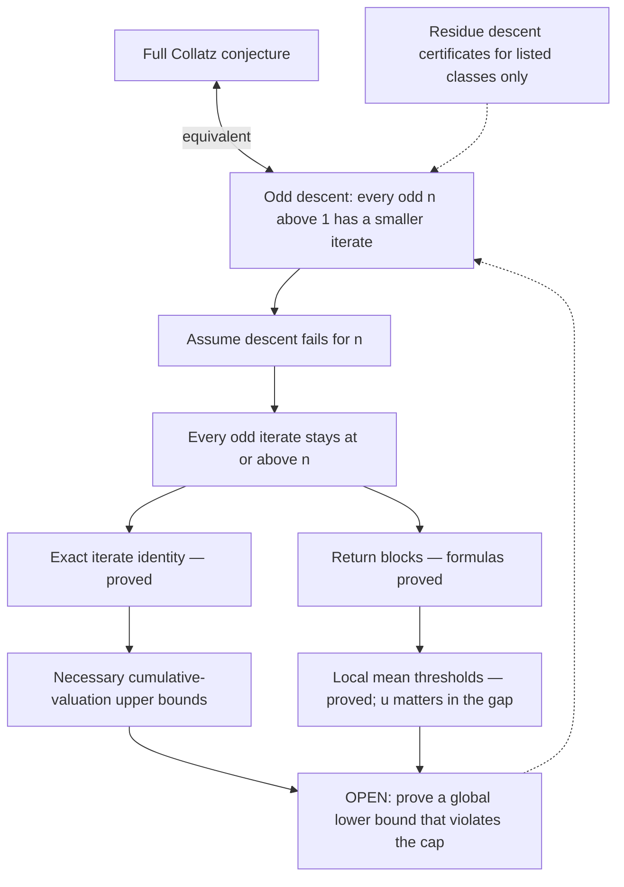

# Collatz Project: a stepwise proof map

## Goal

Define the Collatz map on positive integers by

- `C(n) = n / 2` when `n` is even;
- `C(n) = 3n + 1` when `n` is odd.

The conjecture says every positive integer eventually reaches 1.

For odd inputs, skip the even terms and use the Syracuse map

`S(n) = (3n + 1) / 2^v2(3n + 1)`, for odd `n`,

where `v2(m)` is the exponent of 2 dividing `m`. The output of `S` is odd. Every positive Collatz orbit reaches an odd number after finitely many halvings, so proving that every odd number reaches 1 under `S` is equivalent to the original conjecture.

## A precise proof target

It would suffice to prove the **descent property**:

> For every odd `n > 1`, some iterate `S^j(n)` is strictly smaller than `n`.

If this property holds, strong induction finishes the proof: the smaller odd iterate is below `n`, so by induction it reaches 1, and therefore so does `n`. Conversely, if the Collatz conjecture is true, every odd `n > 1` eventually reaches 1 and hence has a smaller iterate. Thus this is an equivalent target, not an easier theorem already established.

## Exact iterate formula and global descent condition

For an odd starting value `x_0 = n`, define its Syracuse orbit by `x_i = S(x_{i-1})`, the exact 2-adic valuation at step `i` by `a_i = v_2(3x_{i-1}+1)`, and the cumulative valuation by `A_0=0` and `A_j = a_1 + ··· + a_j`. Define `c_0=0` and `c_{j+1}=3c_j+2^{A_j}`. Then for every `j ≥ 1`,

`2^{A_j} x_j = 3^j n + c_j`,

and hence

`c_j = Σ_{i=0}^{j-1} 3^{j-1-i} 2^{A_i}`.

**Proof.** The identity holds at `j=0`. If `2^{A_j}x_j=3^j n+c_j`, then

`2^{A_j+a_{j+1}}x_{j+1} = 3(2^{A_j}x_j)+2^{A_j} = 3^{j+1}n+(3c_j+2^{A_j})`.

This is the same identity at `j+1`; expanding the recurrence for `c_j` gives the sum.

Therefore an iterate is strictly smaller exactly when

`x_j < n  ⇔  (2^{A_j}-3^j)n > c_j`.

In particular, `A_j log 2 > j log 3` is necessary, but it is not by itself sufficient: the positive correction `c_j` must also fit inside the descent margin.

The same condition has a useful logarithmic form:

`log(x_j/n) = j log 3 - A_j log 2 + Σ_{i=0}^{j-1} log(1 + 1/(3x_i))`.

If a hypothetical counterexample never drops below its odd starting value `n`, then `x_i ≥ n` for every `i`, so for every `j` it must satisfy

`A_j log 2 ≤ j log(3 + 1/n)`.

This is a necessary constraint on a non-descending orbit, not a proof that one cannot exist. The next global proof obligation is to derive a structural lower bound on the cumulative valuations along any such orbit that contradicts this upper bound, without enumerating residue classes.

## Exact length of a run with valuation one

Let `x_0=n` be odd, set `x_{i+1}=S(x_i)`, and write `a_{i+1}=v_2(3x_i+1)`. For every integer `r ≥ 0`,

`a_1 = ··· = a_r = 1  ⇔  v_2(n+1) ≥ r+1`.

Thus the initial run of valuation-one steps has exactly `v_2(n+1)-1` terms, followed by a step whose valuation is at least 2.

**Proof.** Whenever `a_{i+1}=1`,

`x_{i+1}+1 = (3x_i+1)/2 + 1 = 3(x_i+1)/2`.

So if the first `r` valuations are 1, iteration gives `x_r+1=3^r(n+1)/2^r`. Since `x_r` is odd, `x_r+1` is even; because `3^r` is odd, this forces `v_2(n+1)≥r+1`. Conversely, suppose `v_2(n+1)≥r+1`. Inductively, before each of the first `r` steps, `v_2(x_i+1)=v_2(n+1)-i≥2`. Hence `3x_i+1=3(x_i+1)-2` is divisible by 2 but not by 4, so `a_{i+1}=1` and `v_2(x_{i+1}+1)=v_2(x_i+1)-1`. After those `r` steps the valuation of `x_r+1` is at least 1. Taking `r=v_2(n+1)-1`, it is exactly 1, so `x_r≡1 (mod 4)` and the next `3x_r+1` is divisible by 4. The run therefore ends exactly there.

**Corollary.** Every infinite Syracuse sequence has infinitely many steps with `a_i≥2`: otherwise all sufficiently late valuations would equal 1, contradicting the finite run-length formula at the odd value where that tail begins. This only proves infinitude, not positive density or a lower bound on cumulative valuations. The global descent problem remains open; a useful next step is to control the lengths of these runs together with the sizes of the valuations that end them.

## Exact return-block formula

Take an odd value `x` with `a=v_2(3x+1)≥2`, and let `y=S(x)`. Set `t=v_2(y+1)` and `u=(y+1)/2^t`, so `u` is odd. The run-length lemma says that the next `t-1` odd steps from `y` all have valuation 1. Let `z` be the value after those `t-1` steps. Then

`z+1 = 3^{t-1}(y+1)/2^{t-1} = 2·3^{t-1}u`,

and substituting `x=(2^a y-1)/3` and `y=2^t u-1` gives the exact block difference

`3(z-x) = 2^a - 2 - u(2^{a+t} - 2·3^t)`.

Consequently this block strictly descends from its own starting value `x` exactly when

`u(2^{a+t} - 2·3^t) > 2^a - 2`.

This gives a critical threshold for possible block descent. Since

`2^{a+t} - 2·3^t = 2^{t+1}(2^{a-1} - (3/2)^t)`,

if `(a+t-1)/t ≤ log_2 3`, then the parenthesized term is nonpositive, so `z-x>0`: the block necessarily expands. Thus a block can strictly descend only if its mean valuation `(a+t-1)/t` is greater than `log_2 3`. This condition is necessary, not sufficient, because the exact descent test still depends on `u`.

A sufficient condition that guarantees descent for every possible odd `u≥1` is

`2^a(2^t - 1) > 2·3^t - 2`.

Writing the block mean as `q=(a+t-1)/t`, this sufficient condition is equivalently

`q > λ_t := 1 + (1/t) log_2((3^t-1)/(2^t-1))`.

The threshold satisfies

`λ_t = log_2 3 + η_t`,  where  `η_t=(1/t)log_2((1-3^{-t})/(1-2^{-t})) > 0`,

and `η_t → 0` as `t → ∞`. More quantitatively, define

`δ_t=(2^{-t}-3^{-t})/(1-2^{-t})`,

so `η_t=(1/t)log_2(1+δ_t)`. Since `0<δ_t<2^{1-t}`, the elementary inequality `log_2(1+δ)≤δ/ln 2` gives

`0 < η_t < 2^{1-t}/(t ln 2)`.

Thus the guaranteed-descent threshold gap is `O(2^{-t}/t)`. Means at most `log_2 3` force expansion; means above `λ_t` guarantee descent regardless of `u`; between these thresholds the coarse test is inconclusive, and the exact `u`-dependent test or its modulo-3 refinement is needed.

Integrality sharpens this local test. From `3x=2^{a+t}u-2^a-1`, reduction modulo 3 gives `u≡0 (mod 3)` when `a` is odd, and `u≡(-1)^{t+1} (mod 3)` when `a` is even. Since `u` is positive and odd, its corresponding lower bound is `u≥3` for odd `a`, `u≥1` for even `a` and odd `t`, and `u≥5` for even `a` and even `t`. Thus, writing `C=2^{a+t}-2·3^t`, a sharper sufficient criterion is `C>0` and `u_min C>2^a-2`, with `u_min` chosen from those three cases.

This is only a local block criterion. For example, `9 → 7 → 11 → 17` is a block with `a=2`, `t=3`, and it grows from 9 to 17.

The block parameters also obey an exact transition law. Index successive blocks by `k`, with block start `x_k`, valuation `a_k`, post-step value `y_k=S(x_k)=2^{t_k}u_k-1`, and next block start `x_{k+1}=2·3^{t_k-1}u_k-1`. Then

`a_{k+1}-1 = v_2(3^{t_k}u_k-1)`,

and, on writing `y_{k+1}=2^{t_{k+1}}u_{k+1}-1`,

`3^{t_k}u_k-1 = 2^{a_{k+1}-1}(2^{t_{k+1}}u_{k+1}-1)`.

Indeed, `3x_{k+1}+1=2(3^{t_k}u_k-1)`, and dividing by its exact power of 2 gives `y_{k+1}`. Thus adjacent block parameters cannot be chosen independently. This is an exact recurrence, but it does not yet bound their long-run averages.

## Exact logarithmic drift across blocks

For block `k`, define

`α_k=(1-2^{1-a_k})/(2^{t_k}u_k)` and `ε_k=log_2(1/(1-α_k))`.

Using `3x_k+1=2^{a_k}y_k`, the same correction has the state-based form

`ε_k=log_2(1+(2^{a_k}-2)/(3(x_k+1)))`.

The endpoint formulas give

`(x_{k+1}+1)/(x_k+1) = 2^{t_k(log_2 3-q_k)}/(1-α_k)`,

where `q_k=(a_k+t_k-1)/t_k`. Hence, after `m` complete blocks,

`log_2((x_{m+1}+1)/(x_1+1)) = Σ_{k=1}^m (t_k(log_2 3-q_k)+ε_k)`.

Since `Σ t_k q_k=Σ(a_k+t_k-1)`, and after the initial run of `r` valuation-one steps the first block start satisfies `x_1+1=(3/2)^r(n+1)`, this is equivalently

`Σ_{k=1}^m (a_k-1) = j log_2(3/2) + Σ_{k=1}^m ε_k - log_2((x_{m+1}+1)/(n+1))`,

where `j=r+Σ t_k` is the total number of odd steps at that block boundary. This identity is exact. On an orbit that never falls below `n`, its final logarithm is nonnegative, so

`Σ(a_k-1) ≤ j log_2(3/2) + Σ ε_k`.

Also `0<α_k<2^{-t_k}`, so `0<ε_k<β_{t_k}:=-log_2(1-2^{-t_k})`. The resulting block-length-sensitive cap is

`Σ(a_k-1) < j log_2(3/2) + Σ β_{t_k}`.

This is another necessary bound for a hypothetical non-descending orbit, not the missing lower bound.

There is also an exact cumulative bookkeeping identity. Let `r` be the initial number of valuation-one steps before the first valuation at least 2, and let `(a_k,t_k)` describe each following complete block. After `m` blocks,

`j = r + Σ_{k=1}^m t_k`,  `A_j = r + Σ_{k=1}^m (a_k+t_k-1)`,

so `A_j-j = Σ_{k=1}^m (a_k-1)`. If the orbit never falls below its starting value `n`, the earlier logarithmic bound therefore forces

`Σ_{k=1}^m (a_k-1) ≤ (r + Σ_{k=1}^m t_k) log_2((3+1/n)/2)`

at every such block boundary. This is a necessary upper bound for a hypothetical non-descending orbit. Proving a contradictory lower bound from the dynamics, while allowing expanding blocks such as the one from 9, is still open.

## Proved descent regions

### Lemma 1: `n ≡ 1 (mod 4)`

If odd `n > 1` and `n ≡ 1 (mod 4)`, then `S(n) < n`.

**Proof.** Write `n = 4k + 1`, where `k ≥ 1`. Then

`3n + 1 = 12k + 4 = 4(3k + 1)`,

so `v2(3n + 1) ≥ 2`. Therefore

`S(n) ≤ (3n + 1) / 4 = 3k + 1 < 4k + 1 = n`.

The exceptional value `n = 1` is already fixed by `S`.

### Lemma 2: `n ≡ 3 (mod 16)`

If `n = 16k + 3`, where `k ≥ 0`, then `S^2(n) < n`.

**Proof.** First, `3n + 1 = 48k + 10 = 2(24k + 5)`, with `24k + 5` odd, so `S(n) = 24k + 5`. Next,

`3S(n) + 1 = 72k + 16 = 8(9k + 2)`,

so `S^2(n) ≤ 9k + 2 < 16k + 3 = n`. The last inequality follows from `7k + 1 > 0`.

### Lemma 3: `n ≡ 11 (mod 64)`

If `n = 64k + 11`, where `k ≥ 0`, then `S^3(n) < n`.

**Proof.** The first two odd steps are exact:

- `3n + 1 = 192k + 34 = 2(96k + 17)`, so `S(n) = 96k + 17`;
- `3S(n) + 1 = 288k + 52 = 4(72k + 13)`, so `S^2(n) = 72k + 13`.

Then `3S^2(n) + 1 = 216k + 40 = 8(27k + 5)`, so `S^3(n) ≤ 27k + 5 < 64k + 11 = n`.

### Lemma 4: `n ≡ 23, 43, or 55 (mod 64)`

For each of these three classes, `S^3(n) < n`.

**Proof.** Write `n = 64k + r`, with `k ≥ 0`.

- If `r = 23`, then `S(n) = 96k + 35` and `S^2(n) = 144k + 53`. Since `3S^2(n) + 1 = 432k + 160 = 16(27k + 10)`, we have `S^3(n) ≤ 27k + 10 < 64k + 23`.
- If `r = 43`, then `S(n) = 96k + 65`, `S^2(n) = 72k + 49`, and `S^3(n) = 54k + 37 < 64k + 43`.
- If `r = 55`, then `S(n) = 96k + 83` and `S^2(n) = 144k + 125`. Since `3S^2(n) + 1 = 432k + 376 = 8(54k + 47)`, we have `S^3(n) ≤ 54k + 47 < 64k + 55`.
### Lemma 5: `n ≡ 7 or 15 (mod 256)`

For each of these two classes, `S^4(n) < n`.

**Proof.** Write `n = 256k + r`, where `k ≥ 0`.

- If `r = 7`, the first three odd iterates are `384k + 11`, `576k + 17`, and `432k + 13`. Since `3S^3(n) + 1 = 1296k + 40 = 8(162k + 5)`, we have `S^4(n) ≤ 162k + 5 < 256k + 7`.
- If `r = 15`, the first three odd iterates are `384k + 23`, `576k + 35`, and `864k + 53`. Since `3S^3(n) + 1 = 2592k + 160 = 16(162k + 10)`, we have `S^4(n) ≤ 162k + 10 < 256k + 15`.

### Lemma 6: `n ≡ 143 (mod 256)`

If `n = 256k + 143`, where `k ≥ 0`, then `S^4(n) < n`.

**Proof.** The first three odd iterates are exact:

- `3n + 1 = 768k + 430 = 2(384k + 215)`, so `S(n) = 384k + 215`;
- `3S(n) + 1 = 1152k + 646 = 2(576k + 323)`, so `S^2(n) = 576k + 323`;
- `3S^2(n) + 1 = 1728k + 970 = 2(864k + 485)`, so `S^3(n) = 864k + 485`.

Finally, `3S^3(n) + 1 = 2592k + 1456 = 16(162k + 91)`. Since `162k + 91` is odd, this valuation is exactly 4 and `S^4(n) = 162k + 91 < 256k + 143 = n`.

### Lemma 7: `n ≡ 187 (mod 256)`

If `n = 256k + 187`, where `k ≥ 0`, then `S^4(n) < n`.

**Proof.** The odd Syracuse iterates are exact:

- `3n + 1 = 768k + 562 = 2(384k + 281)`, so `S(n) = 384k + 281`;
- `3S(n) + 1 = 1152k + 844 = 4(288k + 211)`, so `S^2(n) = 288k + 211`;
- `3S^2(n) + 1 = 864k + 634 = 2(432k + 317)`, so `S^3(n) = 432k + 317`;
- `3S^3(n) + 1 = 1296k + 952 = 8(162k + 119)`, so `S^4(n) = 162k + 119`.

Each quotient in parentheses is odd, so the listed powers of 2 are the exact valuations. Finally, `256k + 187 - (162k + 119) = 94k + 68 > 0`.

### Lemma 8: `n ≡ 39 (mod 256)`

If `n = 256k + 39`, where `k ≥ 0`, then `S^5(n) < n`.

**Proof.** The first four odd Syracuse iterates are exact:

- `3n + 1 = 768k + 118 = 2(384k + 59)`, so `S(n) = 384k + 59`;
- `3S(n) + 1 = 1152k + 178 = 2(576k + 89)`, so `S^2(n) = 576k + 89`;
- `3S^2(n) + 1 = 1728k + 268 = 4(432k + 67)`, so `S^3(n) = 432k + 67`;
- `3S^3(n) + 1 = 1296k + 202 = 2(648k + 101)`, so `S^4(n) = 648k + 101`.

Each displayed quotient is odd. On the fifth step, `3S^4(n) + 1 = 1944k + 304 = 8(243k + 38)`, so `S^5(n) ≤ 243k + 38 < 256k + 39 = n`, since the difference is `13k + 1 > 0`.

### Lemma 9: `n ≡ 79 (mod 256)`

If `n = 256k + 79`, where `k ≥ 0`, then `S^5(n) < n`.

**Proof.** The first four odd Syracuse iterates are exact:

- `3n + 1 = 768k + 238 = 2(384k + 119)`, so `S(n) = 384k + 119`;
- `3S(n) + 1 = 1152k + 358 = 2(576k + 179)`, so `S^2(n) = 576k + 179`;
- `3S^2(n) + 1 = 1728k + 538 = 2(864k + 269)`, so `S^3(n) = 864k + 269`;
- `3S^3(n) + 1 = 2592k + 808 = 8(324k + 101)`, so `S^4(n) = 324k + 101`.

Each displayed quotient is odd. Finally, `3S^4(n) + 1 = 972k + 304 = 4(243k + 76)`, so `S^5(n) ≤ 243k + 76 < 256k + 79 = n`, since the difference is `13k + 3 > 0`.

### Lemma 10: `n ≡ 95 (mod 256)`

If `n = 256k + 95`, where `k ≥ 0`, then `S^5(n) < n`.

**Proof.** The first four odd Syracuse iterates are exact:

- `3n + 1 = 768k + 286 = 2(384k + 143)`, so `S(n) = 384k + 143`;
- `3S(n) + 1 = 1152k + 430 = 2(576k + 215)`, so `S^2(n) = 576k + 215`;
- `3S^2(n) + 1 = 1728k + 646 = 2(864k + 323)`, so `S^3(n) = 864k + 323`;
- `3S^3(n) + 1 = 2592k + 970 = 2(1296k + 485)`, so `S^4(n) = 1296k + 485`.

Each displayed quotient is odd. On the fifth step, `3S^4(n) + 1 = 3888k + 1456 = 16(243k + 91)`, so `S^5(n) ≤ 243k + 91 < 256k + 95 = n`, since the difference is `13k + 4 > 0`.

### Lemma 11: `n ≡ 123 (mod 256)`

If `n = 256k + 123`, where `k ≥ 0`, then `S^5(n) < n`.

**Proof.** The first four odd Syracuse iterates are exact:

- `3n + 1 = 768k + 370 = 2(384k + 185)`, so `S(n) = 384k + 185`;
- `3S(n) + 1 = 1152k + 556 = 4(288k + 139)`, so `S^2(n) = 288k + 139`;
- `3S^2(n) + 1 = 864k + 418 = 2(432k + 209)`, so `S^3(n) = 432k + 209`;
- `3S^3(n) + 1 = 1296k + 628 = 4(324k + 157)`, so `S^4(n) = 324k + 157`.

Each displayed quotient is odd. On the fifth step, `3S^4(n) + 1 = 972k + 472 = 4(243k + 118)`, so `S^5(n) ≤ 243k + 118 < 256k + 123 = n`, since the difference is `13k + 5 > 0`.

### Lemma 12: `n ≡ 59 (mod 256)`

If `n = 256k + 59`, where `k ≥ 0`, then `S^4(n) < n`.

**Proof.** The first three odd Syracuse iterates are exact:

- `3n + 1 = 768k + 178 = 2(384k + 89)`, so `S(n) = 384k + 89`;
- `3S(n) + 1 = 1152k + 268 = 4(288k + 67)`, so `S^2(n) = 288k + 67`;
- `3S^2(n) + 1 = 864k + 202 = 2(432k + 101)`, so `S^3(n) = 432k + 101`.

On the fourth step, `3S^3(n) + 1 = 1296k + 304 = 16(81k + 19)`, so `S^4(n) ≤ 81k + 19 < 256k + 59 = n`, since the difference is `175k + 40 > 0`.

### Lemma 13: `n ≡ 135 (mod 256)`

If `n = 256k + 135`, where `k ≥ 0`, then `S^4(n) < n`.

**Proof.** The first three odd Syracuse iterates are exact:

- `3n + 1 = 768k + 406 = 2(384k + 203)`, so `S(n) = 384k + 203`;
- `3S(n) + 1 = 1152k + 610 = 2(576k + 305)`, so `S^2(n) = 576k + 305`;
- `3S^2(n) + 1 = 1728k + 916 = 4(432k + 229)`, so `S^3(n) = 432k + 229`.

On the fourth step, `3S^3(n) + 1 = 1296k + 688 = 16(81k + 43)`, so `S^4(n) ≤ 81k + 43 < 256k + 135 = n`, since the difference is `175k + 92 > 0`.

### Lemma 14: `n ≡ 199 (mod 256)`

If `n = 256k + 199`, where `k ≥ 0`, then `S^5(n) < n`.

**Proof.** The first four odd Syracuse iterates are exact:

- `3n + 1 = 768k + 598 = 2(384k + 299)`, so `S(n) = 384k + 299`;
- `3S(n) + 1 = 1152k + 898 = 2(576k + 449)`, so `S^2(n) = 576k + 449`;
- `3S^2(n) + 1 = 1728k + 1348 = 4(432k + 337)`, so `S^3(n) = 432k + 337`;
- `3S^3(n) + 1 = 1296k + 1012 = 4(324k + 253)`, so `S^4(n) = 324k + 253`.

Each displayed quotient is odd. On the fifth step, `3S^4(n) + 1 = 972k + 760 = 4(243k + 190)`, so `S^5(n) ≤ 243k + 190 < 256k + 199 = n`, since the difference is `13k + 9 > 0`.

### Lemma 15: `n ≡ 175 (mod 256)`

If `n = 256k + 175`, where `k ≥ 0`, then `S^5(n) < n`.

**Proof.** The first four odd Syracuse iterates are exact:

- `3n + 1 = 768k + 526 = 2(384k + 263)`, so `S(n) = 384k + 263`;
- `3S(n) + 1 = 1152k + 790 = 2(576k + 395)`, so `S^2(n) = 576k + 395`;
- `3S^2(n) + 1 = 1728k + 1186 = 2(864k + 593)`, so `S^3(n) = 864k + 593`;
- `3S^3(n) + 1 = 2592k + 1780 = 4(648k + 445)`, so `S^4(n) = 648k + 445`.

Each displayed quotient is odd. On the fifth step, `3S^4(n) + 1 = 1944k + 1336 = 8(243k + 167)`, so `S^5(n) ≤ 243k + 167 < 256k + 175 = n`, since the difference is `13k + 8 > 0`.

### Lemma 16: `n ≡ 219 (mod 256)`

If `n = 256k + 219`, where `k ≥ 0`, then `S^5(n) < n`.

**Proof.** The first four odd Syracuse iterates are exact:

- `3n + 1 = 768k + 658 = 2(384k + 329)`, so `S(n) = 384k + 329`;
- `3S(n) + 1 = 1152k + 988 = 4(288k + 247)`, so `S^2(n) = 288k + 247`;
- `3S^2(n) + 1 = 864k + 742 = 2(432k + 371)`, so `S^3(n) = 432k + 371`;
- `3S^3(n) + 1 = 1296k + 1114 = 2(648k + 557)`, so `S^4(n) = 648k + 557`.

Each displayed quotient is odd. On the fifth step, `3S^4(n) + 1 = 1944k + 1672 = 8(243k + 209)`, so `S^5(n) ≤ 243k + 209 < 256k + 219 = n`, since the difference is `13k + 10 > 0`.

### Lemma 17: `n ≡ 2587 (mod 4096)`

If `n = 4096k + 2587`, where `k ≥ 0`, then `S^7(n) < n`.

**Proof.** The first six odd Syracuse iterates are exact:

- `3n + 1 = 12288k + 7762 = 2(6144k + 3881)`, so `S(n) = 6144k + 3881`;
- `3S(n) + 1 = 18432k + 11644 = 4(4608k + 2911)`, so `S^2(n) = 4608k + 2911`;
- `3S^2(n) + 1 = 13824k + 8734 = 2(6912k + 4367)`, so `S^3(n) = 6912k + 4367`;
- `3S^3(n) + 1 = 20736k + 13102 = 2(10368k + 6551)`, so `S^4(n) = 10368k + 6551`;
- `3S^4(n) + 1 = 31104k + 19654 = 2(15552k + 9827)`, so `S^5(n) = 15552k + 9827`;
- `3S^5(n) + 1 = 46656k + 29482 = 2(23328k + 14741)`, so `S^6(n) = 23328k + 14741`.

Each displayed quotient is odd. The seventh-step numerator is `3S^6(n) + 1 = 69984k + 44224 = 32(2187k + 1382)`. Therefore `S^7(n) ≤ 2187k + 1382 < 4096k + 2587 = n`, with difference `1909k + 1205 > 0`.

Lemmas 1–4 cover 24 of the 32 odd residue classes modulo 64: all classes `1, 5, 9, 13 (mod 16)`, all of `3 (mod 16)`, and `11, 23, 43, 55 (mod 64)`. Lemmas 5–16 additionally cover `7`, `15`, `39`, `59`, `79`, `95`, `123`, `135`, `143`, `175`, `187`, `199`, and `219 (mod 256)`. Lemma 17 adds the finer class `2587 (mod 4096)`, which lies inside `27 (mod 256)`. Of the four sub-classes of `7 (mod 64)`, `7`, `135`, and `199 (mod 256)` are covered, leaving `71`. Of the four sub-classes of `15 (mod 64)`, `15`, `79`, and `143` are covered, leaving `207`. Of the four sub-classes of `27 (mod 64)`, only `219` is covered as a full class modulo 256; `27`, `91`, and `155` are not covered as full modulo-256 classes, though `2587 (mod 4096)` is covered inside `27`. Of the four sub-classes of `31 (mod 64)`, only `95` is covered; `31`, `159`, and `223` remain. Of the four sub-classes of `39 (mod 64)`, only `39` is covered, leaving `103`, `167`, and `231`. Of the four sub-classes of `47 (mod 64)`, only `175` is covered, leaving `47`, `111`, and `239`. Of the four sub-classes of `59 (mod 64)`, `59`, `123`, and `187` are covered, leaving `251`. The full class `63 (mod 64)` remains unhandled by these certificates.

## Work plan

1. **Fix the definitions and proof target.** Keep the original map and odd-only map explicit. The descent property above is the global obligation.
2. **Work from exact identities.** Derive consequences of the Syracuse recurrence symbolically, keeping each equality and inequality justified for arbitrary odd starting values. The iterate identity, exact valuation-one run length, return-block formulas, modulo-3 restriction, transition law, and logarithmic block drift are proved above.
3. **Seek a global contradiction.** Under the assumption that an odd orbit never falls below its start, prove a structural lower bound on `Σ(a_k-1)` that contradicts the necessary block-boundary upper bounds above. The local block criterion does not suffice by itself: successive block contractions and expansions must be controlled together. Any proposed bound must follow from the exact dynamics, not from finite samples or residue enumeration.
4. **Use local descent certificates as supporting lemmas.** The residue classes listed below are valid partial results and may support a broader proof, but extending the table alone does not close the global descent obligation.
5. **Audit the complete argument.** Check boundary values, the valuation recurrence, and every induction dependency. Keep conjectures, computational observations, and proved statements labeled separately.

## Proof map

## Historical finite check (not a proof strategy)

Reproduce the check with `python collatz_verify.py --limit 100000`. It verifies every starting value from 1 through 100,000 using exact integer arithmetic. The run passed: the largest stopping time was 350 steps at `n = 77,031`, and the largest value observed was 1,570,824,736 from `n = 77,671`. The program memoizes verified tails and stops if it detects a cycle not reaching 1. This is a finite check, not a proof outside the tested interval.

## Literature waypoint

Terence Tao proved that for every function `f(n)` tending to infinity, almost every positive integer in logarithmic density has a Collatz orbit that reaches a value below `f(n)`. This is a deep partial result, but its “almost every” conclusion is not the all-integers statement required here: [Tao, *Almost all orbits of the Collatz map attain almost bounded values* (2019)](https://arxiv.org/abs/1909.03562).

A 2026 exploratory paper on burst/gap dynamics explicitly leaves its key orbitwise hypotheses open, illustrating why a heuristic contraction picture must not be presented as a proof: [Chang, *Exploring Collatz Dynamics with Human-LLM Collaboration* (2026)](https://arxiv.org/abs/2603.11066).

## Status

The exact iterate identity is proved, and Lemmas 1–17 prove strict descent on their listed residue classes. The required global valuation bound remains open; the finite computation is bounded evidence. The full Collatz conjecture has not been proved in this project.
